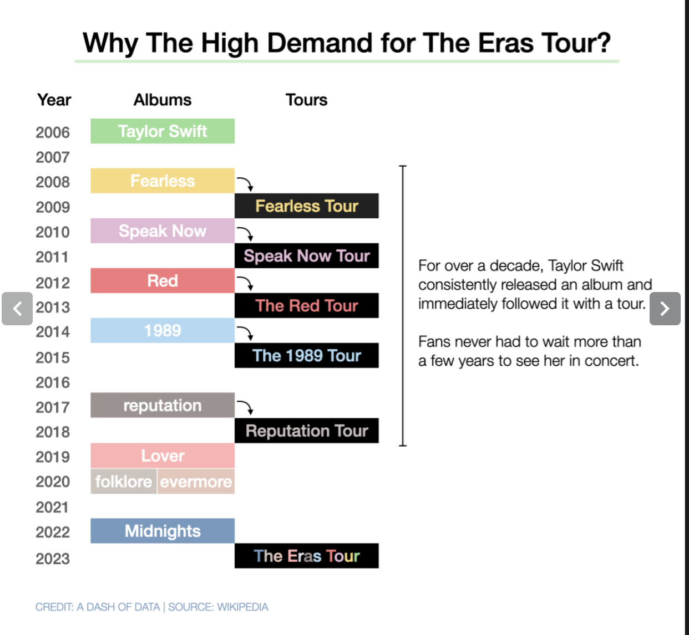
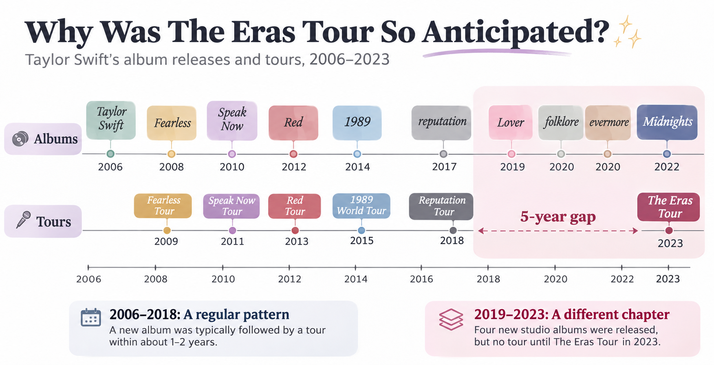
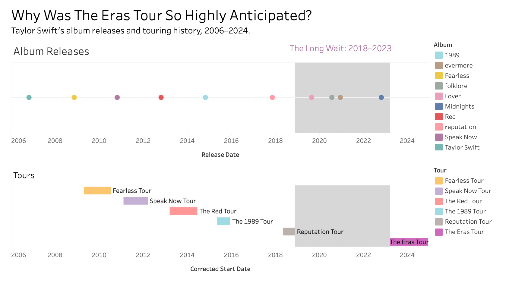

| [Home](README) | [Data Viz Examples](dataviz-examples) | [Critique by Design](critique-by-design) | [Final Project I](final-project-part-one) | [Final Project II](final-project-part-two) | [Final Project III](final-project-part-three) |

# Critique by Design: Taylor Swift's Album Releases and Tours

## Step one: Choose a visualization

I selected the **Taylor Swift Tours** dataset and visualization featured in the MakeoverMonday **2026/W35** challenge. The MakeoverMonday dataset page was my starting point for the assignment. For additional context about the original Eras Tour narrative, I also consulted Alice Zhao's March 2023 article discussing Taylor Swift's album and touring history.

**Original MakeoverMonday source:** [Taylor Swift Tours dataset and visualization](https://makeovermonday.vercel.app/dataset/taylor-swift-tours)

### Original visualization

*Figure 1. Original visualization from the MakeoverMonday Taylor Swift Tours dataset page. Source: MakeoverMonday (2026/W35); original graphic credited to A Dash of Data.*

I selected this visualization because the story is accessible and interesting even for readers who are not deeply familiar with Taylor Swift's career. The relationship between album releases and tours is inherently temporal, making it a useful opportunity to evaluate how visual placement communicates elapsed time. I wanted to retain the author's narrative about the unusual buildup to The Eras Tour while exploring whether the same information could be understood more quickly.

## Step two: Critique the original

I used Stephen Few's *Data Visualization Effectiveness Profile* to consider usefulness, completeness, perceptibility, truthfulness, intuitiveness, aesthetics, and engagement. I also applied the framework from Chapter 3 of *Good Charts*. I would classify the original as **data-driven and declarative**: it uses specific album and tour dates to communicate a preselected narrative about the anticipation surrounding The Eras Tour.

One strength is its use of album-associated colors, which makes the history recognizable and engaging for fans. Its chronological arrangement also gives readers a useful overview of how records and tours followed one another.

My central concern was **the perceptibility of elapsed time**. The story depends on the unusually long interval between the Reputation Tour and The Eras Tour, yet this comparison is not visually emphasized as strongly as it could be. Readers must inspect dates and annotations to infer the scale of the gap. For a declarative visualization, the main contrast should be immediately legible.

The title also goes beyond what the timeline can establish on its own. Album and tour histories provide plausible context for anticipation, but these data alone cannot measure ticket demand or prove its causes. In my redesign I therefore aim to make the *timeline evidence* more persuasive visually, while keeping this analytical limitation clear.

## Step three: Sketch a solution

My initial concept was a **dual-track, time-proportional horizontal timeline**: album releases above, tours below, both using the same continuous date scale. Equal distances on the horizontal axis would represent equal periods of time. Album-specific colors would preserve some of the personality of the original, while a highlighted interval would direct attention to the break between tours.

I also considered a more traditional timeline and an album-composition chart. I ultimately preferred the dual-track layout because it preserves the original purpose and enables a direct comparison of album releases with touring activity.

### Initial redesign sketch

**Initial concept sketch:** The digital sketch below was generated with ChatGPT based on my proposed dual-track, time-proportional layout. It includes two tracks, a highlighted touring gap, and explanatory callouts. The final Tableau design simplifies this initial composition.

## Step four: Test the solution

During our in-class critique, my classmates offered several specific suggestions about the initial dual-track timeline. The recurring theme was **reducing unnecessary visual complexity while preserving the temporal information that matters to the story**. I used this feedback to guide the transition from the initial sketch to the Tableau dashboard.

### Peer feedback and changes made

| Feedback from classmates | Change in the final Tableau redesign |
| --- | --- |
| **The timeline repeats too many times.** The sketch contains separate album and tour lines as well as an additional year scale. | I simplified the design to two main tracks, Album Releases and Tours, with a consistent, time-proportional horizontal scale. I removed the extra decorative timeline from the sketch and avoided repeating the same explanatory callouts. |
| **Tours should be shown as periods of time, rather than single points.** | I used **Gantt bars** extending from each tour's start date to its end date, while keeping **circles** for individual album release dates. This makes the difference between a dated release and an extended tour explicit. |
| **The labels become crowded, particularly when releases are close together.** | I removed the individual album-name labels from the marks, retained a color-coded **Album legend**, and placed **Tour names** next to the Gantt bars for easier identification. |
| **The color keys and labels need to be easier to follow.** | I used a consistent album-inspired palette across the two tracks and retained the **Album and Tour legends** so readers can decode the colors. I also reduced on-chart text to limit clutter. |
| **The most important comparison needs stronger visual emphasis.** | I added matching **reference bands** to both tracks for the period between the end of the Reputation Tour and the start of The Eras Tour, and used a brief explanatory annotation to connect the gap with the four studio albums released during that period. |

### What I learned

The feedback helped me recognize that simplicity and accuracy have to work together. Removing repeated visual elements made the composition cleaner, but an equally important improvement was choosing the right mark type for each event: circles for one-day releases and duration bars for tours. Aligning the tracks on the same date scale and emphasizing the touring gap made the main story easier to perceive without asking readers to calculate intervals themselves.

## Step five: Build the solution in Tableau

I built the final redesign in **Tableau Public**, retaining the two horizontal tracks with a shared proportional date range. The upper track uses colored circles for studio-album release dates, and the lower track uses Gantt bars to show tour durations. Text labels identify tours, while the color legend identifies albums.

The original song-by-tour spreadsheet contained tour names, start and end dates, album names, and song titles, but it did not contain studio-album release dates. I supplemented it with album release dates for the ten studio albums available at the time of the 2023 article.

While building the chart, I discovered inconsistent dates for The Red Tour in the provided spreadsheet. Some rows placed it in 2011–2012, overlapping the Speak Now tour. I corrected those records to **March 13, 2013 through June 12, 2014** for the timeline and used the corrected dates to calculate tour durations.

I added a **reference band from November 21, 2018 to March 17, 2023**, showing the interval between the end of the Reputation Tour and the beginning of The Eras Tour. The exact between-tour interval is approximately four years and four months; describing 2018 to 2023 as five years is a year-to-year shorthand. During that period, *Lover*, *folklore*, *evermore*, and *Midnights* were released. Using this same highlighted period in both tracks makes the relationship between releases and the touring gap easier to see.

### Final Tableau Dashboard

*Figure 3. Final Tableau redesign showing album release dates, tour durations, and the highlighted interval before The Eras Tour.*

**Interactive version:** [Explore the Tableau Public dashboard](https://public.tableau.com/app/profile/qianyu.liu/viz/TaylorSwiftToursRedesign/Dashboard1).

The most important change from the original is the use of **position and distance as explicit encodings of time**. The result is intended to help viewers perceive the gap directly and identify the four releases that preceded The Eras Tour. It offers historical context for anticipation while avoiding claims of causation that the underlying data cannot independently verify.

## References

- [MakeoverMonday, 2026/W35: Taylor Swift Tours (original dataset and visualization)](https://makeovermonday.vercel.app/dataset/taylor-swift-tours)
- [Alice Zhao, *A Data Scientist Breaks Down All 10 Taylor Swift Albums (The Extended Version)*, March 1, 2023](https://adashofdata.com/2023/03/01/a-data-scientist-breaks-down-all-10-taylor-swift-albums-the-extended-version/)
- Scott Berinato, *Good Charts*, Chapters 3–4.
- Stephen Few, *Data Visualization Effectiveness Profile*.
- Taylor Swift studio album release dates: [Add the specific reference consulted for the supplementary dates.]

## AI acknowledgements

I used ChatGPT as a brainstorming and technical support tool for this project. It helped me compare redesign approaches, articulate the critique, develop a preliminary digital concept sketch, and troubleshoot Tableau steps such as calculations, Gantt bars, labels, date axes, and reference bands. I constructed and refined the final visualization in Tableau Public. AI also assisted in drafting and editing the written reflection, which I reviewed against my design decisions and project work.

[Home](README) · [Data Viz Examples](dataviz-examples)
