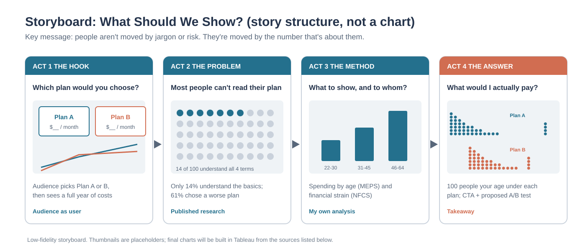
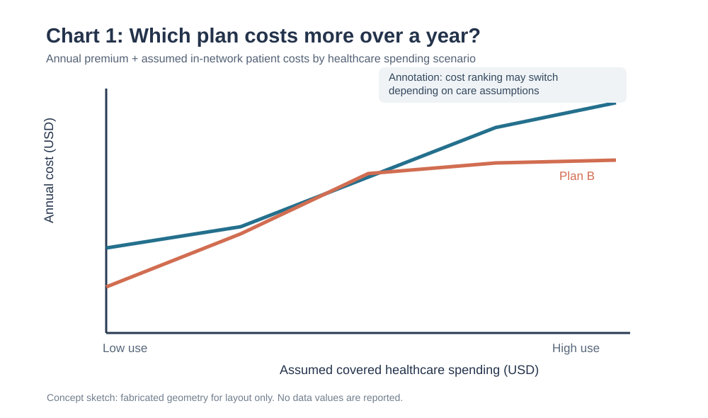
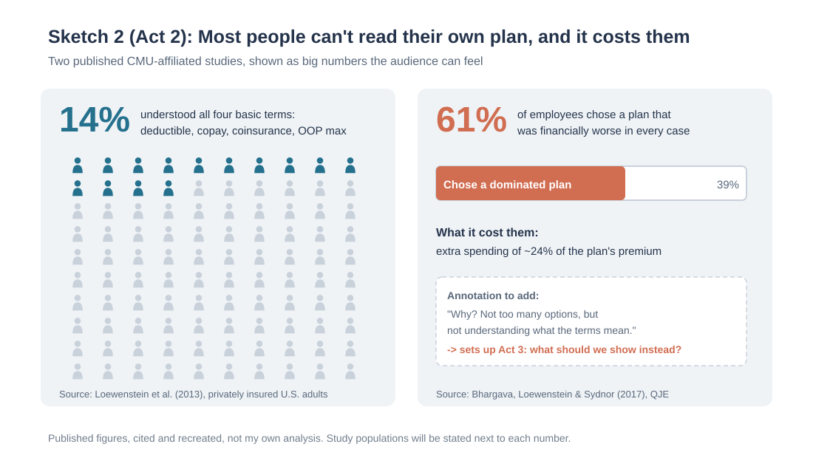
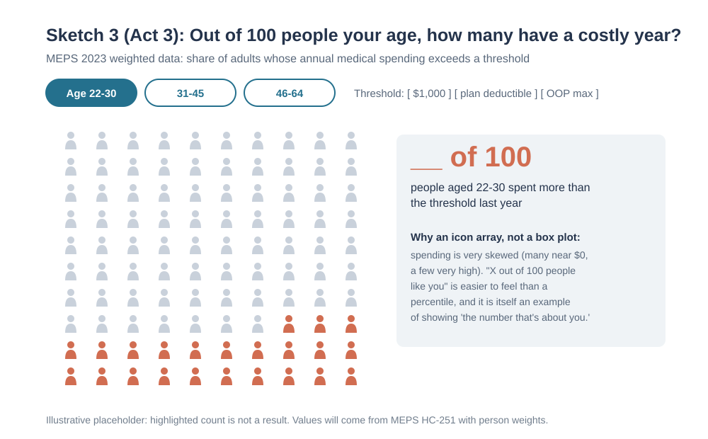
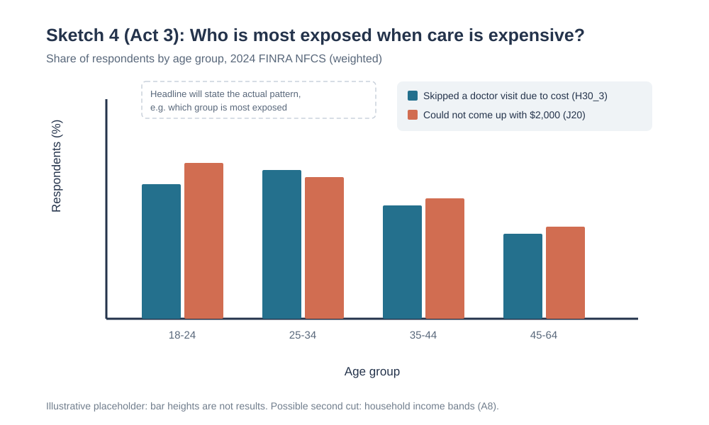
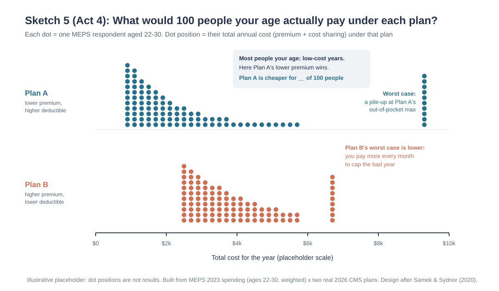

# Final Project Part I: What Should We Show?

**Subtitle:** Using data to identify the information people need to make better health insurance decisions  
**Student:** Qianyu (Amy) Liu  
**Course:** Telling Stories with Data  
**Status:** Proposal and initial sketches, November 2026

[Portfolio home](README.md) | [Outline](#1-project-outline) | [Initial sketches](#2-initial-sketches) | [Data](#3-data-sources-and-analysis-plan) | [Method and medium](#4-method-and-medium) | [References](#references)

> **One-sentence story:** People aren't moved by insurance jargon or by warnings about risk. They're moved by the number that's about them: *"What would I actually pay this year?"*

## 1. Project Outline

### Project summary

Health insurance is one of the first complicated financial decisions many young adults encounter after graduation. A plan may advertise an attractive monthly premium, yet the amount a person pays can also depend on deductibles, copayments, coinsurance, provider networks, and out-of-pocket limits. For students accustomed to university health coverage, comparing plans through an employer or the individual insurance marketplace can be unfamiliar. I want to tell a data-driven story about why a seemingly simple health insurance decision is difficult and how clearer information might help. Research involving Carnegie Mellon scholars has documented confusion about insurance terminology and financially disadvantageous plan choices. This makes health insurance a practical case study in information design.

My central question is **how a product team can determine which information to show a particular consumer**. Rather than assuming every consumer needs a longer explanation of policy terms, I will explore how a decision-maker's context and information gaps can guide the presentation. I plan to combine published behavioral research with public data on medical expenditures, insurance plan attributes, and financial circumstances. The narrative moves from an audience-facing plan-choice exercise to evidence of misunderstanding, then proposes a three-part information selection framework: **Relevance, Uncertainty, and Decision Impact**. My answer, built up through the story, is that the most persuasive information is the number that is about the viewer: *what would I actually pay this year?* The project aims to make insurance choices more understandable for classmates while demonstrating a transferable method for evidence-based product design, one that applies equally to an insurance app or a local-business page.

### Audience and communication goals

**Primary audience:** U.S.-based graduate students and young professionals who may soon review employer-sponsored health insurance benefits or individual-market insurance options. Available plans and costs depend on employer, eligibility, location, and year.

The audience should leave knowing that:

1. **As users:** the monthly premium is only part of what a plan costs; the number that matters is the total for a year like yours.
2. **As future designers:** people aren't moved by jargon or by risk warnings, but by a personal number. Different people need different numbers first, depending on their spending and financial cushion.
3. **As evidence-minded builders:** decide what to show using three tests (Relevance, Uncertainty, Decision Impact), then verify with an experiment.

**Call to action for consumers:** Before you enroll, find your plan's out-of-pocket maximum and price out one scenario like yours (e.g., one ER visit).  
**Call to action for product designers:** Don't explain the terms. Show users what they would pay, starting with the uncertainty that matters most to them.

### Story structure: Four acts

| Act | Audience question | Story and planned visualization |
| --- | --- | --- |
| **Act 1. The Hook: Which plan would you choose?** | Which option looks cheaper? | Show two comparable health insurance plan cards with premiums and deductibles, ask for an initial choice, then reveal a chart of total annual costs across care scenarios. |
| **Act 2. The Problem: Why is the choice hard?** | What makes seemingly straightforward decisions go wrong? | Big-number visuals from published research: only 14% of insured adults understood four basic terms, and 61% of employees in one firm chose a financially dominated plan. |
| **Act 3. The Method: What should we show?** | How can we identify the information a consumer needs? | Combine age-group medical-spending distributions (MEPS), indicators of financial resilience (NFCS), and insurance-literacy findings to build an evidence-to-message matrix. Introduce **Relevance, Uncertainty, Decision Impact**. |
| **Act 4. The Answer: What would I actually pay?** | What should a product show instead of the plan table? | A consequence graph: 100 MEPS respondents aged 22–30, each placed at what they would have paid for the year under Plan A and Plan B. Shows the typical year, the worst case, and for how many people each plan is cheaper. Ends with the call to action and a proposed A/B test. |

### Story arc

**Setup:** A graduating student encounters unfamiliar health insurance options.  
**Tension:** A cheaper premium looks attractive, but a high deductible and other cost-sharing terms may change the overall financial outcome.  
**Discovery:** Published studies show comprehension challenges; public datasets illuminate spending variation and financial exposure.  
**Resolution:** A consequence graph shows what people your age would actually pay under each plan, in a typical year and in the worst case.  
**Takeaway:** Understand a user's uncertainty, prioritize decision-relevant information, and experimentally test whether it helps.

### User stories

- **Recent graduate:** As a person choosing coverage, I want to compare potential **total annual costs** of different plans under realistic assumptions so I do not choose based on premium alone.
- **Financially constrained consumer:** As a person with limited emergency savings, I want to understand my possible **out-of-pocket exposure** so I can assess affordability.
- **Product designer:** As a designer, I want evidence about what people misunderstand and which facts affect their decisions so I can prioritize the right information rather than overwhelming users.

### Proposed framework: Choosing what information to show

| Step | Key question | Evidence and method | Information worth testing |
| --- | --- | --- | --- |
| **Relevance** | What decision is this user making, in what context? | Weighted medical-spending patterns by age (MEPS), with carefully defined illustrative usage scenarios | A range of potential annual costs relevant to the scenario |
| **Uncertainty** | What does the user likely misunderstand or overlook? | Published comprehension studies, product-language analysis, and survey indicators | Plain-language deductible, coinsurance, and out-of-pocket examples |
| **Decision Impact** | Could the new information materially improve the decision? | Scenario-based plan calculations, existing behavioral experiments, and a proposed randomized evaluation | Total premium + estimated in-network cost sharing, with caveats |

**Why "what would I pay?" is the information to lead with:** it meets all three tests. It is *relevant* (tied to a year like yours), it corrects a common *misunderstanding* (a low premium is not the same as a low annual cost), and published experiments suggest that showing people the financial consequences of each plan, rather than asking them to work it out from the terms, leads to fewer dominated choices. Whether it works for this audience is the hypothesis a future A/B test would check.

## 2. Initial Sketches

The sketches follow the four acts in order: a storyboard of the whole story first, then one sketch per key visual. All values are placeholders; final numbers will come from the data sources in Section 3.

### Story overview

This storyboard shows the story structure and the headline for each act; it is not a chart. Each act has one headline question and one main visual. The story moves from **the audience as a user** (Act 1), to **published evidence** (Act 2), to **my own analysis** (Act 3), and ends with **a design takeaway and call to action** (Act 4).

### Sketch 1 (Act 1): The cheaper premium isn't always the cheaper year

**Chart:** Two lines, one per plan. **X-axis:** care scenarios from "no visits" to "very high use". **Y-axis:** total annual cost (12 months of premium plus cost sharing). **Data:** two real 2026 plans from the CMS files; scenarios grounded in MEPS spending. **Point:** the audience picks a plan first, then sees where the "cheap" plan becomes the expensive one. The flat segments show where the out-of-pocket maximum caps each plan.

### Sketch 2 (Act 2): Most people can't read their own plan, and it costs them

**Visual:** two big numbers. An icon array shows that only 14 of 100 privately insured adults understood all four basic terms; a bar shows that 61% of employees at one firm chose a plan that was financially worse in every scenario. **Data:** published research (Loewenstein et al., 2013; Bhargava, Loewenstein & Sydnor, 2017), recreated and cited, with each study population stated. **Point:** the problem is not too many options; it's not understanding what the terms mean. This sets up Act 3.

### Sketch 3 (Act 3): Out of 100 people your age, how many have a costly year?

**Visual:** an icon array of 100 people with an age-group selector (22–30, 31–45, 46–64) and a threshold selector (e.g., $1,000, a typical deductible, the out-of-pocket maximum). **Data:** MEPS 2023, weighted. **Why an icon array instead of a box plot:** medical spending is very skewed (many people spend almost nothing, a few spend a lot), so a box plot would be squashed and hard to read. "X out of 100 people like you" is easier to feel, and is itself an example of showing the number that's about the viewer.

### Sketch 4 (Act 3): Who is most exposed when care is expensive?

**Chart:** grouped bars for four age groups (18–24, 25–34, 35–44, 45–64). **Indicators:** skipped a doctor visit because of cost (NFCS item H30_3) and could not come up with $2,000 for an unexpected expense (J20). **Data:** 2024 FINRA NFCS, weighted. **Point:** the groups with the least cushion are the ones for whom the out-of-pocket number matters most, so they should see it first. The final headline will state the pattern the data actually shows.

### Sketch 5 (Act 4): What would 100 people your age actually pay under each plan?

**Chart:** a "consequence graph" (two stacked dot plots). Each dot is one MEPS respondent aged 22–30; its position is the total they would have paid that year (12 months of premium plus cost sharing) under each plan. **Data:** my own calculation combining MEPS 2023 spending (weighted) with the terms of two real 2026 CMS plans. **Point:** this is the climax and the answer to "what should we show?" Instead of a table of terms, the viewer sees the typical year (the big cluster), the worst case (the pile-up at the out-of-pocket maximum), and how many people their age would be better off with each plan. Showing the whole distribution rather than one average follows Samek & Sydnor (2020), who found that showing only expected values was about half as effective as showing the full set of consequences. **Call to action:** before you enroll, find your plan's out-of-pocket maximum and price out one year like yours. **Next step:** an A/B test comparing a standard plan table with this graph, measuring comprehension, choice quality and trust.

## 3. Data Sources and Analysis Plan

### Primary data source 1: Medical Expenditure Panel Survey (MEPS)

The **2023 MEPS Full Year Consolidated File (HC-251)**, published by the Agency for Healthcare Research and Quality, provides publicly downloadable individual-level demographic characteristics, annual healthcare expenditure measures, and sampling weights. I will use it to calculate weighted annual spending distributions by age group (Sketch 3) and to define realistic care scenarios for the plan comparison (Sketches 1 and 5). Key fields: age (`AGE23X`), total expenditure (`TOTEXP23`), and person weight (`PERWT23F`); the out-of-pocket field will be confirmed in the codebook. The file is also available in Excel format, which can be loaded directly into Tableau.

- [MEPS HC-251 public-use dataset](https://meps.ahrq.gov/mepsweb/data_stats/download_data_files_detail.jsp?cboPufNumber=HC-251&prfricon=yes)
- [HC-251 documentation and file formats](https://meps.ahrq.gov/data_stats/download_data/pufs/h251/h251doc.shtml)

### Primary data source 2: CMS Marketplace Public Use Files

The **2026 Centers for Medicare & Medicaid Services Marketplace Public Use Files** include downloadable files describing plan attributes, premiums, and benefits/cost-sharing features. I will pick two real plans in the same area, one with a lower premium and higher deductible and one with the opposite, and use their premiums, deductibles, coinsurance and out-of-pocket maximums to calculate the total annual cost lines in Sketch 1 and, applied to each MEPS respondent's spending, the dot positions in Sketch 5. If I use Pennsylvania plans, they come from the separate State-Based Marketplace files.

- [CMS Marketplace Public Use Files](https://www.cms.gov/marketplace/resources/data/public-use-files)
- [CMS State-Based Marketplace Public Use Files](https://www.cms.gov/marketplace/resources/data/state-based-public-use-files)

### Primary data source 3: FINRA National Financial Capability Study

The **FINRA Investor Education Foundation's 2024 National Financial Capability Study (NFCS)** offers a publicly accessible survey dataset, questionnaire, and supporting documentation. I will compare age groups (`A3a`) and income bands (`A8`) on two indicators: skipping a doctor or clinic visit because of cost in the past 12 months (`H30_3`) and confidence in coming up with $2,000 for an unexpected need within a month (`J20`). This is my own segmentation analysis for Sketch 4: it shows who has the least financial cushion, and therefore who most needs to see their out-of-pocket exposure.

- [2024 NFCS public data, questionnaire, and methodology](https://www.finrafoundation.org/nfcs-data-and-downloads)

### Published behavioral research

Three published studies supply the evidence for Acts 2 and 4. I will recreate the key figures in a small CSV in this repository, with citations.

- **Loewenstein et al. (2013):** among privately insured U.S. adults, only **14%** understood all four basic concepts (deductible, copay, coinsurance, out-of-pocket maximum). [CMU news release](https://www.cmu.edu/news/stories/archives/2013/august/aug1_understandinghealthinsurance.html)
- **Bhargava, Loewenstein & Sydnor (2017), "Choose to Lose":** **61%** of employees at a large U.S. firm chose a financially dominated plan, and the main driver was a lack of understanding of the plans, not the size of the menu. [Journal article](https://doi.org/10.1093/qje/qjx011)
- **Samek & Sydnor (2020), "Impact of Consequence Information on Insurance Choice":** in two experiments, people choosing from standard feature-based information violated dominance at high rates; a "consequence graph" showing premiums plus out-of-pocket costs significantly improved choices, while showing only expected values was about half as effective. This is the evidence behind the consequence graph in Sketch 5. [NBER working paper](https://www.nber.org/papers/w28003)

### Proposed analytical workflow

1. Download MEPS HC-251 and verify relevant variable definitions. Create a tidy file with age, annual spending fields, and person weights; estimate appropriately weighted distributions and percentiles.
2. Download the 2024 NFCS survey plus codebook. Check coding, missingness, and applicable weights before comparing age groups and financial circumstances.
3. Download the applicable 2026 CMS Marketplace files. Identify geographically comparable plans using documented joins; inspect benefits and provider/network differences.
4. Compute **illustrative**, clearly labeled annual total costs for the selected plans under explicit healthcare utilization assumptions. Keep MEPS expenditure statistics distinct from actual Marketplace cost-sharing calculations.
5. Create Tableau visualizations: a plan-cost scenario chart, weighted expenditure distributions, and subgroup comparisons. Use informative annotations and sources, including assumptions and denominators.
6. Build the consequence graph by applying each plan's terms to every MEPS respondent aged 22–30, and design a future A/B test comparing a standard plan table with the graph.

### Access and reproducibility status

All three datasets are publicly downloadable from the links above, and the variables needed have been identified. Cleaned extracts, the plan-cost calculation for Sketches 1 and 5, and a short data dictionary will be added to this repository in Part II.

## 4. Method and Medium

I plan to build a **Tableau Public data story** with linked worksheets and dashboards, using interactive filters or parameters where practical. My **GitHub portfolio page** will provide the narrative sequence, context, sources, and links to the Tableau visualizations, creating a publicly accessible final project. I will focus on a small set of annotated charts with a clear progression from the initial insurance-plan choice to evidence on information needs and then a proposed design principle. The work will use tools introduced in class and will avoid PowerPoint or Excel as the final medium. If a separate interactive story platform becomes necessary, I will check with the instructor before adopting it.

## Limitations and ethical considerations

- **No causal claims from my own data.** MEPS and NFCS describe spending and financial context. They cannot show which message a person finds persuasive or how a display changes enrollment; that evidence comes from the published experiments, and testing it with this audience is left to the proposed A/B test.
- **Published figures keep their original populations.** The 14% and 61% figures describe the studies' samples (privately insured adults in 2013; employees at one firm), not today's students.
- **Marketplace plans are not employer plans.** The CMS plans are used because their terms are public; employer plans have the same structure (premium, deductible, coinsurance, out-of-pocket maximum) but different prices.
- **Spending is not the same as what you owe.** MEPS reports total spending; actual costs under a plan depend on negotiated prices, networks and coverage rules. Scenario costs will be labeled as estimates.
- **Not insurance advice.** The consequence graph is a design concept. A future test should measure comprehension, choice quality, trust and potential harm, not just clicks or enrollment.
- **No sketch values are results.** All marks in the sketches are placeholders.

## References

1. Agency for Healthcare Research and Quality. *Medical Expenditure Panel Survey: 2023 Full Year Consolidated File (HC-251).* https://meps.ahrq.gov/mepsweb/data_stats/download_data_files_detail.jsp?cboPufNumber=HC-251&prfricon=yes
2. Bhargava, S., Loewenstein, G., & Sydnor, J. (2017). “Choose to Lose: Health Plan Choices from a Menu with Dominated Option.” *The Quarterly Journal of Economics, 132*(3), 1319–1372. https://doi.org/10.1093/qje/qjx011
3. Carnegie Mellon University. (2013). *Consumers Don't Understand Health Insurance, Carnegie Mellon Research Shows.* https://www.cmu.edu/news/stories/archives/2013/august/aug1_understandinghealthinsurance.html
4. Centers for Medicare & Medicaid Services. *Marketplace Public Use Files.* https://www.cms.gov/marketplace/resources/data/public-use-files
5. FINRA Investor Education Foundation. *National Financial Capability Study: Data and Downloads.* https://www.finrafoundation.org/nfcs-data-and-downloads
6. Samek, A., & Sydnor, J. R. (2020). "Impact of Consequence Information on Insurance Choice." NBER Working Paper No. 28003. https://doi.org/10.3386/w28003

## AI acknowledgements

I used ChatGPT and Claude to help brainstorm and scope the research question, organize the four-act narrative, identify and verify candidate public data sources, draft and edit this proposal, and draw the sketches. The data sources, research claims, analytical assumptions, and final work will be reviewed and validated before publication. No original statistical analysis is presented as completed in this Part I proposal.

[Back to portfolio](README.md) | [Back to top](#final-project-part-i-what-should-we-show)
