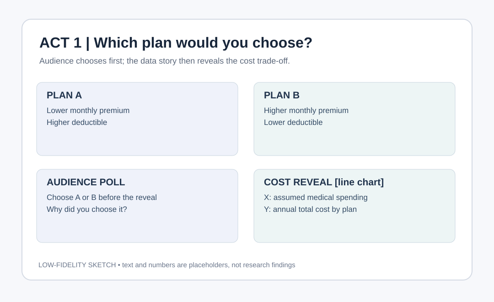
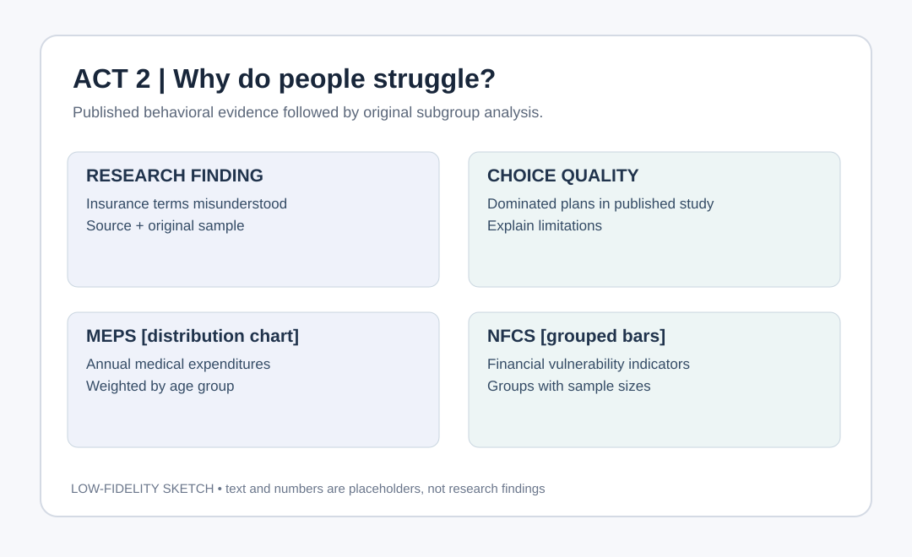

# Final Project Part I: What Should We Show?

**Subtitle:** Using data to identify the information people need to make better health insurance decisions  
**Student:** Qianyu (Amy) Liu  
**Course:** Telling Stories with Data  
**Status:** Proposal and initial sketches, November 2026

[Portfolio home](README.md) | [Outline](#1-project-outline) | [Initial sketches](#2-initial-sketches) | [Data](#3-data-sources-and-analysis-plan) | [Method and medium](#4-method-and-medium) | [References](#references)

> **One-sentence story:** To design useful insurance information, first identify the consumer's decision, uncertainty, and financial context. Then show the evidence most relevant to that decision and test whether the presentation actually helps.

## 1. Project Outline

### Project summary

Health insurance is one of the first complicated financial decisions many young adults encounter after graduation. A plan may advertise an attractive monthly premium, yet the amount a person pays can also depend on deductibles, copayments, coinsurance, provider networks, and out-of-pocket limits. For students accustomed to university health coverage, comparing plans through an employer or the individual insurance marketplace can be unfamiliar. I want to tell a data-driven story about why a seemingly simple health insurance decision is difficult and how clearer information might help. Research involving Carnegie Mellon scholars has documented confusion about insurance terminology and financially disadvantageous plan choices. This makes health insurance a practical case study in information design.

My central question is **how a product team can determine which information to show a particular consumer**. Rather than assuming every consumer needs a longer explanation of policy terms, I will explore how a decision-maker's context and information gaps can guide the presentation. I plan to combine published behavioral research with public data on medical expenditures, insurance plan attributes, and financial circumstances. The narrative moves from an audience-facing plan-choice exercise to evidence of misunderstanding, then proposes a three-part information selection framework: **Relevance, Uncertainty, and Decision Impact**. Finally, I will sketch a personalized comparison interface and explain how its effectiveness could be tested. The project aims to make insurance choices more understandable for classmates while demonstrating a transferable method for evidence-based product design.

### Audience and communication goals

**Primary audience:** U.S.-based graduate students and young professionals who may soon review employer-sponsored health insurance benefits or individual-market insurance options. Available plans and costs depend on employer, eligibility, location, and year.

The audience should leave knowing that:

1. A monthly premium is only one part of a health insurance plan's possible annual cost.
2. Different consumers may require different information because their healthcare needs, financial exposure, and uncertainties differ.
3. A useful comparison should prioritize relevant, trustworthy information and then measure whether it improves comprehension and decisions.

**Call to action for consumers:** Compare annual costs across plausible usage scenarios, examine the out-of-pocket maximum, and verify provider-network and benefit rules.  
**Call to action for product designers:** Identify the user's actual decision and information gap before deciding which statistics deserve prominence.

### Story structure: Four acts

| Act | Audience question | Story and planned visualization |
| --- | --- | --- |
| **Act 1. The Hook: Which plan would you choose?** | Which option looks cheaper? | Show two comparable health insurance plan cards with premiums and deductibles, ask for an initial choice, then reveal a chart of total annual costs across clearly stated care scenarios. Marketplace plans will be labeled accurately and will not be represented as employer benefits. |
| **Act 2. The Problem: Why is the choice hard?** | What makes seemingly straightforward decisions go wrong? | Use clearly attributed published research on insurance comprehension and financially dominated choices. Explain study populations and distinguish results from current student behavior. |
| **Act 3. The Method: What should we show?** | How can we identify the information a consumer needs? | Combine age-group medical-spending distributions (MEPS), indicators of financial resilience (NFCS), and insurance-literacy findings to build an evidence-to-message matrix. Introduce **Relevance, Uncertainty, Decision Impact**. |
| **Act 4. The Design: From data to a decision aid** | What would an improved product actually display? | Contrast a jargon-heavy plan comparison with transparent, scenario-based annual costs. Sketch a user-context or care-scenario selector and propose an experiment to test comprehension, decision quality, and trust. |

### Story arc

**Setup:** A graduating student encounters unfamiliar health insurance options.  
**Tension:** A cheaper premium looks attractive, but a high deductible and other cost-sharing terms may change the overall financial outcome.  
**Discovery:** Published studies show comprehension challenges; public datasets illuminate spending variation and financial exposure.  
**Resolution:** A decision aid identifies which information is personally relevant and explains trade-offs in plain language.  
**Takeaway:** Understand a user's uncertainty, prioritize decision-relevant information, and experimentally test whether it helps.

### User stories

- **Recent graduate:** As a person choosing coverage, I want to compare potential **total annual costs** of different plans under realistic assumptions so I do not choose based on premium alone.
- **Financially constrained consumer:** As a person with limited emergency savings, I want to understand my possible **out-of-pocket exposure** so I can assess affordability.
- **Product designer:** As a designer, I want evidence about what people misunderstand and which facts affect their decisions so I can prioritize the right information rather than overwhelming users.

### Proposed framework: Choosing what information to show

| Step | Key question | Evidence and method | Information worth testing |
| --- | --- | --- | --- |
| **Relevance** | What decision is this user making, in what context? | Weighted medical-spending patterns by age (MEPS), with carefully defined illustrative usage scenarios | A range of potential annual costs relevant to the scenario |
| **Uncertainty** | What does the user likely misunderstand or overlook? | Published comprehension studies, product-language analysis, and survey indicators | Plain-language deductible, coinsurance, and out-of-pocket examples |
| **Decision Impact** | Could the new information materially improve the decision? | Scenario-based plan calculations, existing behavioral experiments, and a proposed randomized evaluation | Total premium + estimated in-network cost sharing, with caveats |

**Evidence boundary:** Public population datasets can describe financial circumstances and healthcare expenditure patterns. They cannot identify what an individual will find persuasive, establish which message has the highest conversion rate, or demonstrate causation. The proposed personalized display is a **design hypothesis** that would need testing.

## 2. Initial sketches

The following low-fidelity sketches illustrate the planned story, including headings, charts, explanatory narrative, and interactions. They are **wireframes**, so the illustrated content should not be interpreted as statistical results.

### Sketch 1. Act 1: The opening choice

Viewers choose between **Plan A** and **Plan B** based on visible summary details. A follow-up visualization shows how the relative annual cost changes across care scenarios. In the final piece, example plans will come from the **same market, location, year, and comparable coverage category**. Differences in benefit coverage and provider networks will be disclosed.

### Sketch 2. Act 2: Evidence and segments

Published research supplies the problem; original analysis of public data provides the population context. Charts will report data source, sample population, time period, survey weights where appropriate, and limitations. A published estimate about employees in a particular firm will not be presented as a result about CMU students.

### Sketch 3. Acts 3 and 4: Method and solution

The framework leads to a proposed interactive product: users select a hypothetical context, see scenario-specific annual-cost ranges and trade-offs, and can inspect the assumptions underlying each visualization. The design distinguishes empirical observations, hypothetical computations, and recommendations.

## 3. Data Sources and Analysis Plan

### Primary data source 1: Medical Expenditure Panel Survey (MEPS)

The **2023 MEPS Full Year Consolidated File (HC-251)**, published by the Agency for Healthcare Research and Quality, provides publicly downloadable individual-level demographic characteristics, annual healthcare expenditure measures, and sampling weights. I plan to calculate weighted annual expenditure distributions for younger adults and compare age groups. Relevant fields in the published file documentation include age (`AGE23X`), total expenditure (`TOTEXP23`), and person weight (`PERWT23F`). Before using an out-of-pocket measure, I will verify its precise name and definition in the codebook. These descriptive estimates can help ground relatable care-spending scenarios, but MEPS total expenditures cannot be used as a direct substitute for a plan's negotiated allowed charges or a patient's liability under a specific policy.

- [MEPS HC-251 public-use dataset](https://meps.ahrq.gov/mepsweb/data_stats/download_data_files_detail.jsp?cboPufNumber=HC-251&prfricon=yes)
- [HC-251 documentation and file formats](https://meps.ahrq.gov/data_stats/download_data/pufs/h251/h251doc.shtml)

### Primary data source 2: CMS Marketplace Public Use Files

The **2026 Centers for Medicare & Medicaid Services Marketplace Public Use Files** include downloadable files describing plan attributes, premiums, and benefits/cost-sharing features. I plan to obtain the relevant Plan Attributes, Rate, and Benefits and Cost Sharing files to identify two comparable individual-market plans in one location. The comparison will reference the correct plan year, location, premiums, deductibles, out-of-pocket limits, and any relevant cost-sharing conditions. Detailed annual cost examples will require explicit assumptions about services, network status, negotiated charges, copays, coinsurance, deductible applicability, and covered benefits. These plans represent **Marketplace options, not employer-sponsored insurance**; the distinction will be clear throughout the story.

- [CMS Marketplace Public Use Files](https://www.cms.gov/marketplace/resources/data/public-use-files)
- [CMS State-Based Marketplace Public Use Files](https://www.cms.gov/marketplace/resources/data/state-based-public-use-files)

### Primary data source 3: FINRA National Financial Capability Study

The **FINRA Investor Education Foundation's 2024 National Financial Capability Study (NFCS)** offers a publicly accessible survey dataset, questionnaire, and supporting documentation. I plan to examine relevant demographic and financial-strain variables to compare consumer segments, subject to verifying the exact item wording, variable codes, survey weights, and missing data. If the questionnaire contains suitable cost-related care avoidance or emergency-savings questions, these may contextualize how financial vulnerability shapes the information consumers need. Survey associations will be interpreted descriptively; the dataset does not reveal individual preferences for competing insurance messages.

- [2024 NFCS public data, questionnaire, and methodology](https://www.finrafoundation.org/nfcs-data-and-downloads)

### Published behavioral research

Two sources provide evidence for the information-design problem:

- A **2013 Carnegie Mellon report on insurance understanding** summarizes a study where only **14%** of respondents understood all four concepts tested. This figure will be attributed to its original study population and will not be presented as a statistic about contemporary students. [CMU news article](https://www.cmu.edu/news/stories/archives/2013/august/aug1_understandinghealthinsurance.html).
- **Bhargava, Loewenstein, and Sydnor (2017), “Choose to Lose,”** examines plan selections by employees at a U.S. firm and documents financially dominated health-plan choices. These findings help establish that decision errors can be consequential, although they do not validate my proposed interface. [Journal article](https://doi.org/10.1093/qje/qjx011).

### Proposed analytical workflow

1. Download MEPS HC-251 and verify relevant variable definitions. Create a tidy file with age, annual spending fields, and person weights; estimate appropriately weighted distributions and percentiles.
2. Download the 2024 NFCS survey plus codebook. Check coding, missingness, and applicable weights before comparing age groups and financial circumstances.
3. Download the applicable 2026 CMS Marketplace files. Identify geographically comparable plans using documented joins; inspect benefits and provider/network differences.
4. Compute **illustrative**, clearly labeled annual total costs for the selected plans under explicit healthcare utilization assumptions. Keep MEPS expenditure statistics distinct from actual Marketplace cost-sharing calculations.
5. Create Tableau visualizations: a plan-cost scenario chart, weighted expenditure distributions, and subgroup comparisons. Use informative annotations and sources, including assumptions and denominators.
6. Translate the findings into a decision-aid mockup and design a future test comparing a traditional plan table with an accessible scenario-based presentation.

### Access and reproducibility status

At the Part I stage, official public download locations and candidate fields have been identified. **The raw datasets have not yet been downloaded into this repository or processed into the proposed results.** The above links give publicly accessible sources for the data. During the next phase, I will add appropriately sized cleaned extracts and a data dictionary or methodology note to the repository, subject to source terms. The sketches contain no empirical estimates. I will not invent results, message-effect sizes, or conversion improvements.

## 4. Method and Medium

I plan to create a stand-alone **scrollytelling website in Shorthand**, supported by interactive visualizations made in **Tableau Public**. The narrative will begin with a short plan-choice exercise and then advance through research evidence, original descriptive analysis, and the Relevance–Uncertainty–Decision Impact framework. The closing concept may be built with embedded interaction or Tableau parameters, depending on platform support. All visuals will include readable labels, annotations, data sources, and limitations. GitHub will serve as the development portfolio and provide a public link to the finished story. PowerPoint and Excel will not serve as the final presentation medium.

## Limitations and ethical considerations

- These public datasets describe spending and financial context, not real-time insurance purchasing behavior or message-response experiments.
- Personalized displays in this proposal are hypotheses, not validated recommendations or insurance advice.
- Healthcare spending and insurance plan liability involve different measurements; provider networks, coverage rules, and negotiated prices may materially change actual costs.
- Marketplace examples cannot represent the options offered by an employer.
- A future A/B test should evaluate comprehension, decision quality, trust, and potential harm alongside engagement or enrollment.
- Any published statistics will be recreated with proper citations; copyrighted figures or internal employer data will not be copied.

## References

1. Agency for Healthcare Research and Quality. *Medical Expenditure Panel Survey: 2023 Full Year Consolidated File (HC-251).* https://meps.ahrq.gov/mepsweb/data_stats/download_data_files_detail.jsp?cboPufNumber=HC-251&prfricon=yes
2. Bhargava, S., Loewenstein, G., & Sydnor, J. (2017). “Choose to Lose: Health Plan Choices from a Menu with Dominated Option.” *The Quarterly Journal of Economics, 132*(3), 1319–1372. https://doi.org/10.1093/qje/qjx011
3. Carnegie Mellon University. (2013). *Consumers Don't Understand Health Insurance, Carnegie Mellon Research Shows.* https://www.cmu.edu/news/stories/archives/2013/august/aug1_understandinghealthinsurance.html
4. Centers for Medicare & Medicaid Services. *Marketplace Public Use Files.* https://www.cms.gov/marketplace/resources/data/public-use-files
5. FINRA Investor Education Foundation. *National Financial Capability Study: Data and Downloads.* https://www.finrafoundation.org/nfcs-data-and-downloads

## AI acknowledgements

I used ChatGPT to help brainstorm and scope the research question, organize the four-act narrative, identify candidate public data sources, draft and edit this proposal, and generate initial wireframe sketches. The data sources, research claims, analytical assumptions, and final work will be reviewed and validated before publication. No original statistical analysis is presented as completed in this Part I proposal.

[Back to portfolio](README.md) | [Back to top](#final-project-part-i-what-should-we-show)
