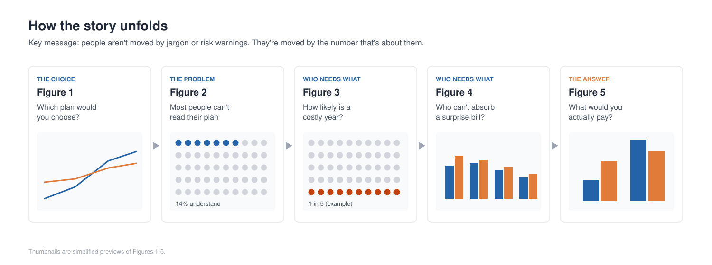
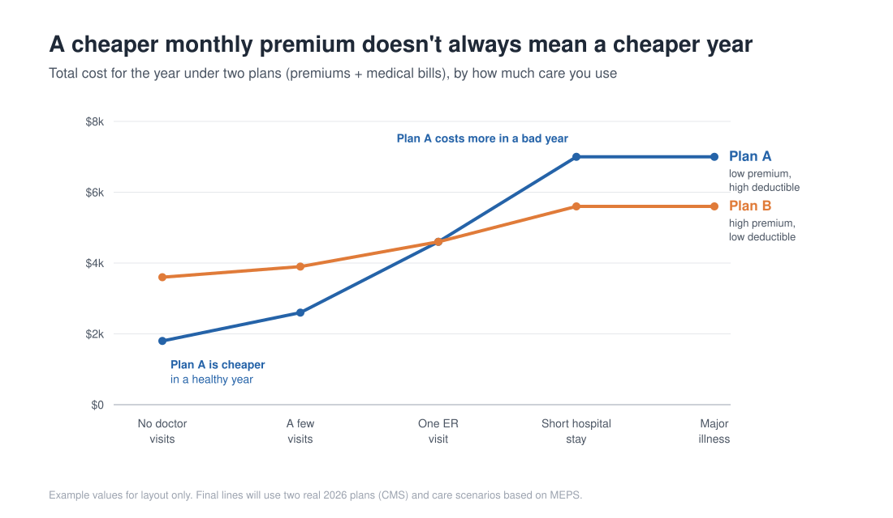
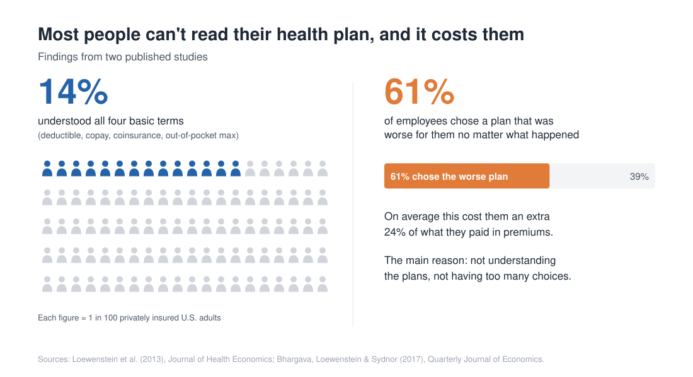
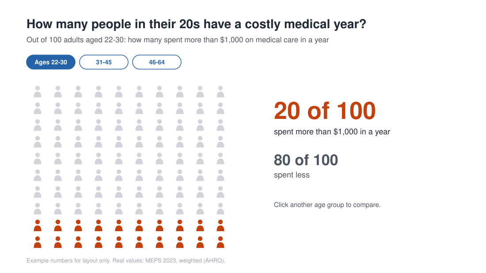
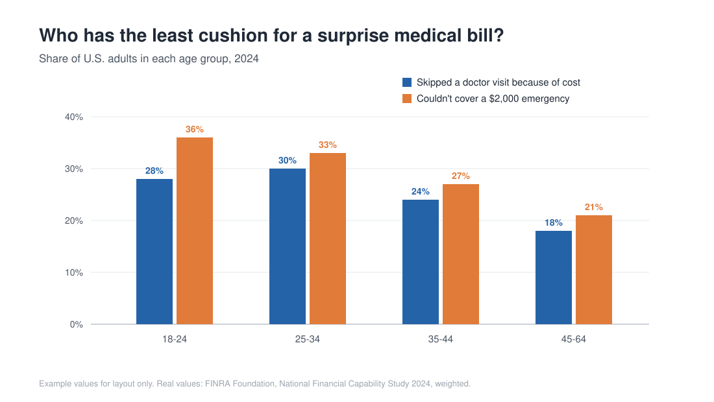
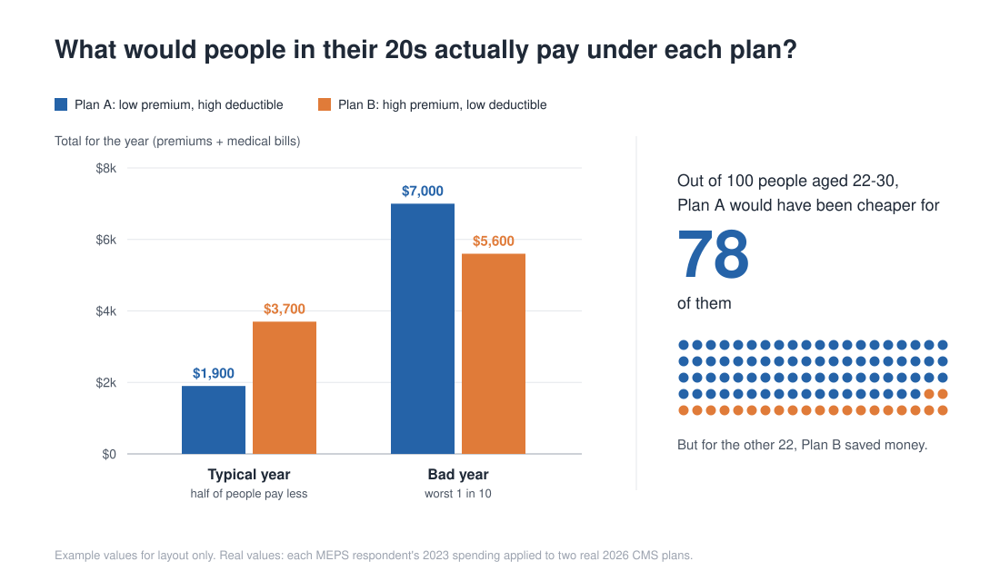

# Final Project Part I: What Should We Show?

**Subtitle:** Using data to identify the information people need to make better health insurance decisions  
**Student:** Qianyu (Amy) Liu  
**Course:** Telling Stories with Data  
**Status:** Proposal and initial sketches, November 2026

[Portfolio home](README.md) | [Outline](#1-project-outline) | [Initial sketches](#2-initial-sketches) | [Data](#3-data-sources-and-analysis-plan) | [Method and medium](#4-method-and-medium) | [References](#references)

> **One-sentence story:** People aren't moved by insurance jargon or by warnings about risk. They're moved by the number that's about them: *"What would I actually pay this year?"*

## 1. Project Outline

### Project summary

Health insurance is one of the first complicated financial decisions many young adults encounter after graduation. A plan may advertise an attractive monthly premium, yet the amount a person pays can also depend on deductibles, copayments, coinsurance, provider networks, and out-of-pocket limits. For students accustomed to university health coverage, comparing plans through an employer or the individual insurance marketplace can be unfamiliar. I want to tell a data-driven story about why a seemingly simple health insurance decision is difficult and how clearer information might help. Research involving Carnegie Mellon scholars has documented confusion about insurance terminology and financially disadvantageous plan choices. This makes health insurance a practical case study in information design.

My central question is **how a product team can determine which information to show a particular consumer**. Rather than assuming every consumer needs a longer explanation of policy terms, I will explore how a decision-maker's context and information gaps can guide the presentation. I plan to combine published behavioral research with public data on medical expenditures, insurance plan attributes, and financial circumstances. The narrative moves from an audience-facing plan-choice exercise to evidence of misunderstanding, then proposes a three-part information selection framework: **Relevance, Uncertainty, and Decision Impact**. My answer, built up through the story, is that the most persuasive information is the number that is about the viewer: *what would I actually pay this year?* The project aims to make insurance choices more understandable for classmates while demonstrating a transferable method for evidence-based product design, one that applies equally to an insurance app or a local-business page.

### Audience and communication goals

**Primary audience:** U.S.-based graduate students and young professionals who may soon review employer-sponsored health insurance benefits or individual-market insurance options. Available plans and costs depend on employer, eligibility, location, and year.

The audience should leave knowing that:

1. **As users:** the monthly premium is only part of what a plan costs; the number that matters is the total for a year like yours.
2. **As future designers:** people aren't moved by jargon or by risk warnings, but by a personal number. Different people need different numbers first, depending on their spending and financial cushion.
3. **As evidence-minded builders:** decide what to show using three tests (Relevance, Uncertainty, Decision Impact), then verify with an experiment.

**Call to action for consumers:** Before you enroll, find your plan's out-of-pocket maximum and price out one scenario like yours (e.g., one ER visit).  
**Call to action for product designers:** Don't explain the terms. Show users what they would pay, starting with the uncertainty that matters most to them.

### Story structure: Four parts, five figures

| Part | Question for the audience | Figure |
| --- | --- | --- |
| **1. The choice** | Which plan would you choose? | **Figure 1:** total yearly cost of two plans, from a healthy year to a major illness. The audience picks a plan first, then sees where the "cheap" plan becomes the expensive one. |
| **2. The problem** | Why do people get this wrong? | **Figure 2:** two findings from published research: only 14% of insured adults understood four basic terms, and 61% of employees at one firm chose a plan that was worse for them in every case. |
| **3. Who needs what** | What should each person see first? | **Figure 3:** out of 100 people your age, how many have a costly medical year (MEPS). **Figure 4:** which age groups have the least cushion for a surprise bill (NFCS). Together they introduce the three tests: **Relevance, Uncertainty, Decision Impact**. |
| **4. The answer** | What would I actually pay? | **Figure 5:** what people aged 22–30 would pay under each plan in a typical year and in a bad year, and for how many of 100 people each plan is cheaper. Ends with the call to action and a proposed A/B test. |

### Story arc

**Setup:** A graduating student encounters unfamiliar health insurance options.  
**Tension:** A cheaper premium looks attractive, but a high deductible and other cost-sharing terms may change the overall financial outcome.  
**Discovery:** Published studies show comprehension challenges; public datasets illuminate spending variation and financial exposure.  
**Resolution:** Show what people your age would actually pay under each plan, in a typical year and in a bad year.  
**Takeaway:** Understand a user's uncertainty, prioritize decision-relevant information, and experimentally test whether it helps.

### User stories

- **Recent graduate:** As a person choosing coverage, I want to compare potential **total annual costs** of different plans under realistic assumptions so I do not choose based on premium alone.
- **Financially constrained consumer:** As a person with limited emergency savings, I want to understand my possible **out-of-pocket exposure** so I can assess affordability.
- **Product designer:** As a designer, I want evidence about what people misunderstand and which facts affect their decisions so I can prioritize the right information rather than overwhelming users.

### Proposed framework: Choosing what information to show

| Step | Key question | Evidence and method | Information worth testing |
| --- | --- | --- | --- |
| **Relevance** | What decision is this user making, in what context? | Weighted medical-spending patterns by age (MEPS), with carefully defined illustrative usage scenarios | A range of potential annual costs relevant to the scenario |
| **Uncertainty** | What does the user likely misunderstand or overlook? | Published comprehension studies, product-language analysis, and survey indicators | Plain-language deductible, coinsurance, and out-of-pocket examples |
| **Decision Impact** | Could the new information materially improve the decision? | Scenario-based plan calculations, existing behavioral experiments, and a proposed randomized evaluation | Total premium + estimated in-network cost sharing, with caveats |

**Why "what would I pay?" is the information to lead with:** it meets all three tests. It is *relevant* (tied to a year like yours), it corrects a common *misunderstanding* (a low premium is not the same as a low annual cost), and published experiments suggest that showing people the financial consequences of each plan, rather than asking them to work it out from the terms, leads to fewer dominated choices. Whether it works for this audience is the hypothesis a future A/B test would check.

## 2. Initial Sketches

A storyboard of the whole story, followed by one sketch per figure. Numbers in Figures 1, 3, 4 and 5 are example values to show the layout; the real values will come from the data in Section 3. Figure 2 uses published figures.

### Storyboard

The story moves from a choice the audience makes themselves (Figure 1), to published evidence (Figure 2), to my own analysis of who needs which information (Figures 3–4), and ends with the answer and the call to action (Figure 5).

### Figure 1: A cheaper monthly premium doesn't always mean a cheaper year

Each line is one plan. Moving right, the person uses more medical care that year. Plan A (low premium, high deductible) is cheaper in a healthy year, but the lines cross and Plan A costs more in a bad year. The lines flatten when each plan's out-of-pocket maximum is reached. **Data:** two real 2026 plans (CMS); care scenarios based on MEPS.

### Figure 2: Most people can't read their health plan, and it costs them

Left: of 100 privately insured adults, only 14 understood deductible, copay, coinsurance and out-of-pocket maximum. Right: 61% of employees at a large U.S. firm chose a plan that was worse for them whatever happened, costing an extra 24% of their premiums; the main reason was not understanding the plans. **Data:** Loewenstein et al. (2013); Bhargava, Loewenstein & Sydnor (2017).

### Figure 3: How many people in their 20s have a costly medical year?

Each figure is one person out of 100 in the selected age group; highlighted people spent more than $1,000 on medical care that year. Viewers can switch age groups. An icon array is used instead of a box plot because medical spending is very uneven (most people spend little, a few spend a lot), and "X out of 100 people like you" is easier to grasp. **Data:** MEPS 2023, weighted.

### Figure 4: Who has the least cushion for a surprise medical bill?

For each age group, blue is the share who skipped a doctor visit because of cost (NFCS item `H30_3`) and orange is the share who couldn't come up with $2,000 for an emergency (`J20`). Groups with the least cushion are the ones who most need to see their worst-case cost first. **Data:** FINRA NFCS 2024, weighted.

### Figure 5: What would people in their 20s actually pay under each plan?

This is the answer to "what should we show?" Instead of a table of plan terms, it shows the number that matters to the viewer. **Left:** what a person aged 22–30 would pay for the year under each plan, in a typical year (the middle person) and a bad year (the worst 1 in 10). **Right:** out of 100 people that age, for how many each plan would have been cheaper. Showing both the typical and the bad year, not just one average, follows Samek & Sydnor (2020), who found that showing only expected values was about half as effective as showing the full range of outcomes. **Data:** each MEPS respondent's 2023 spending applied to the two CMS plans. **Call to action:** before you enroll, find your plan's out-of-pocket maximum and price out one year like yours. **Next step:** an A/B test comparing a standard plan table with this view, measuring comprehension, choice quality and trust.

## 3. Data Sources and Analysis Plan

### Primary data source 1: Medical Expenditure Panel Survey (MEPS)

The **2023 MEPS Full Year Consolidated File (HC-251)**, published by the Agency for Healthcare Research and Quality, provides publicly downloadable individual-level demographic characteristics, annual healthcare expenditure measures, and sampling weights. I will use it to calculate weighted annual spending distributions by age group (Figure 3) and to define realistic care scenarios for the plan comparison (Figures 1 and 5). Key fields: age (`AGE23X`), total expenditure (`TOTEXP23`), and person weight (`PERWT23F`); the out-of-pocket field will be confirmed in the codebook. The file is also available in Excel format, which can be loaded directly into Tableau.

- [MEPS HC-251 public-use dataset](https://meps.ahrq.gov/mepsweb/data_stats/download_data_files_detail.jsp?cboPufNumber=HC-251&prfricon=yes)
- [HC-251 documentation and file formats](https://meps.ahrq.gov/data_stats/download_data/pufs/h251/h251doc.shtml)

### Primary data source 2: CMS Marketplace Public Use Files

The **2026 Centers for Medicare & Medicaid Services Marketplace Public Use Files** include downloadable files describing plan attributes, premiums, and benefits/cost-sharing features. I will pick two real plans in the same area, one with a lower premium and higher deductible and one with the opposite, and use their premiums, deductibles, coinsurance and out-of-pocket maximums to calculate the cost lines in Figure 1 and, applied to each MEPS respondent's spending, the results in Figure 5. If I use Pennsylvania plans, they come from the separate State-Based Marketplace files.

- [CMS Marketplace Public Use Files](https://www.cms.gov/marketplace/resources/data/public-use-files)
- [CMS State-Based Marketplace Public Use Files](https://www.cms.gov/marketplace/resources/data/state-based-public-use-files)

### Primary data source 3: FINRA National Financial Capability Study

The **FINRA Investor Education Foundation's 2024 National Financial Capability Study (NFCS)** offers a publicly accessible survey dataset, questionnaire, and supporting documentation. I will compare age groups (`A3a`) and income bands (`A8`) on two indicators: skipping a doctor or clinic visit because of cost in the past 12 months (`H30_3`) and confidence in coming up with $2,000 for an unexpected need within a month (`J20`). This is my own segmentation analysis for Figure 4: it shows who has the least financial cushion, and therefore who most needs to see their out-of-pocket exposure.

- [2024 NFCS public data, questionnaire, and methodology](https://www.finrafoundation.org/nfcs-data-and-downloads)

### Published behavioral research

Three published studies supply the evidence for Figures 2 and 5. I will recreate the key figures in a small CSV in this repository, with citations.

- **Loewenstein et al. (2013):** among privately insured U.S. adults, only **14%** understood all four basic concepts (deductible, copay, coinsurance, out-of-pocket maximum). [CMU news release](https://www.cmu.edu/news/stories/archives/2013/august/aug1_understandinghealthinsurance.html)
- **Bhargava, Loewenstein & Sydnor (2017), "Choose to Lose":** **61%** of employees at a large U.S. firm chose a financially dominated plan, and the main driver was a lack of understanding of the plans, not the size of the menu. [Journal article](https://doi.org/10.1093/qje/qjx011)
- **Samek & Sydnor (2020), "Impact of Consequence Information on Insurance Choice":** in two experiments, people choosing from standard feature-based information violated dominance at high rates; a "consequence graph" showing premiums plus out-of-pocket costs significantly improved choices, while showing only expected values was about half as effective. This is the evidence behind Figure 5. [NBER working paper](https://www.nber.org/papers/w28003)

### Proposed analytical workflow

1. Download MEPS HC-251 and verify relevant variable definitions. Create a tidy file with age, annual spending fields, and person weights; estimate appropriately weighted distributions and percentiles.
2. Download the 2024 NFCS survey plus codebook. Check coding, missingness, and applicable weights before comparing age groups and financial circumstances.
3. Download the applicable 2026 CMS Marketplace files. Identify geographically comparable plans using documented joins; inspect benefits and provider/network differences.
4. Compute **illustrative**, clearly labeled annual total costs for the selected plans under explicit healthcare utilization assumptions. Keep MEPS expenditure statistics distinct from actual Marketplace cost-sharing calculations.
5. Create Tableau visualizations: a plan-cost scenario chart, weighted expenditure distributions, and subgroup comparisons. Use informative annotations and sources, including assumptions and denominators.
6. Build Figure 5 by applying each plan's terms to every MEPS respondent aged 22–30, and design a future A/B test comparing a standard plan table with that view.

### Access and reproducibility status

Extracts of all three datasets, keeping only the variables this project uses, are in the [data folder](data/README.md) of this repository, together with a data dictionary: MEPS 2023 (`data/meps_2023_extract.csv`), 2026 Pennsylvania plans and premiums (`data/cms_pa_2026_plans.csv`, `data/cms_pa_2026_rates_age22_30.csv`), and NFCS 2024 (`data/nfcs_2024_extract.csv`). The published figures used in Figure 2 are recreated in `data/published_findings.csv`. The plan-cost calculation for Figures 1 and 5 will be added in Part II.

## 4. Method and Medium

I plan to build a **Tableau Public data story** with linked worksheets and dashboards, using interactive filters or parameters where practical. My **GitHub portfolio page** will provide the narrative sequence, context, sources, and links to the Tableau visualizations, creating a publicly accessible final project. I will focus on a small set of annotated charts with a clear progression from the initial insurance-plan choice to evidence on information needs and then a proposed design principle. The work will use tools introduced in class and will avoid PowerPoint or Excel as the final medium. If a separate interactive story platform becomes necessary, I will check with the instructor before adopting it.

## Limitations and ethical considerations

- **No causal claims from my own data.** MEPS and NFCS describe spending and financial context. They cannot show which message a person finds persuasive or how a display changes enrollment; that evidence comes from the published experiments, and testing it with this audience is left to the proposed A/B test.
- **Published figures keep their original populations.** The 14% and 61% figures describe the studies' samples (privately insured adults in 2013; employees at one firm), not today's students.
- **Marketplace plans are not employer plans.** The CMS plans are used because their terms are public; employer plans have the same structure (premium, deductible, coinsurance, out-of-pocket maximum) but different prices.
- **Spending is not the same as what you owe.** MEPS reports total spending; actual costs under a plan depend on negotiated prices, networks and coverage rules. Scenario costs will be labeled as estimates.
- **Not insurance advice.** Figure 5 is a design concept. A future test should measure comprehension, choice quality, trust and potential harm, not just clicks or enrollment.
- **Example values are not results.** Numbers in Figures 1, 3, 4 and 5 are placeholders until the data is processed.

## References

1. Agency for Healthcare Research and Quality. *Medical Expenditure Panel Survey: 2023 Full Year Consolidated File (HC-251).* https://meps.ahrq.gov/mepsweb/data_stats/download_data_files_detail.jsp?cboPufNumber=HC-251&prfricon=yes
2. Bhargava, S., Loewenstein, G., & Sydnor, J. (2017). “Choose to Lose: Health Plan Choices from a Menu with Dominated Option.” *The Quarterly Journal of Economics, 132*(3), 1319–1372. https://doi.org/10.1093/qje/qjx011
3. Carnegie Mellon University. (2013). *Consumers Don't Understand Health Insurance, Carnegie Mellon Research Shows.* https://www.cmu.edu/news/stories/archives/2013/august/aug1_understandinghealthinsurance.html
4. Centers for Medicare & Medicaid Services. *Marketplace Public Use Files.* https://www.cms.gov/marketplace/resources/data/public-use-files
5. FINRA Investor Education Foundation. *National Financial Capability Study: Data and Downloads.* https://www.finrafoundation.org/nfcs-data-and-downloads
6. Samek, A., & Sydnor, J. R. (2020). "Impact of Consequence Information on Insurance Choice." NBER Working Paper No. 28003. https://doi.org/10.3386/w28003

## AI acknowledgements

I used ChatGPT and Claude to help brainstorm and scope the research question, organize the narrative, identify and verify candidate public data sources, draft and edit this proposal, and draw the sketches. The data sources, research claims, analytical assumptions, and final work will be reviewed and validated before publication. No original statistical analysis is presented as completed in this Part I proposal.

[Back to portfolio](README.md) | [Back to top](#final-project-part-i-what-should-we-show)
