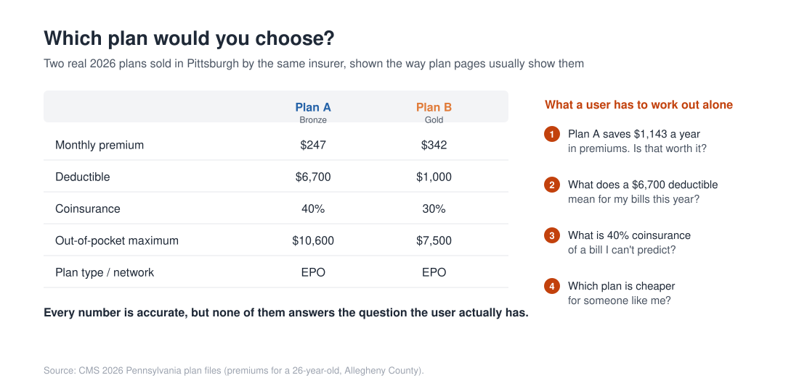
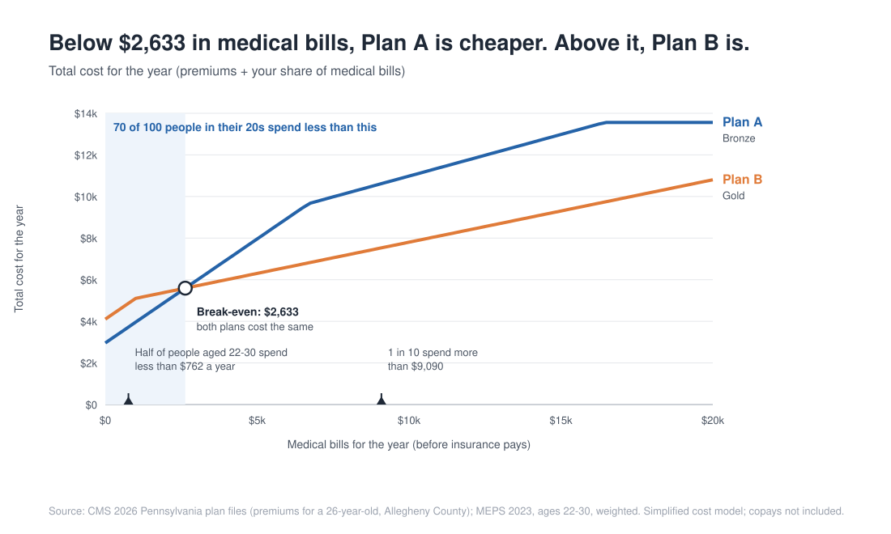
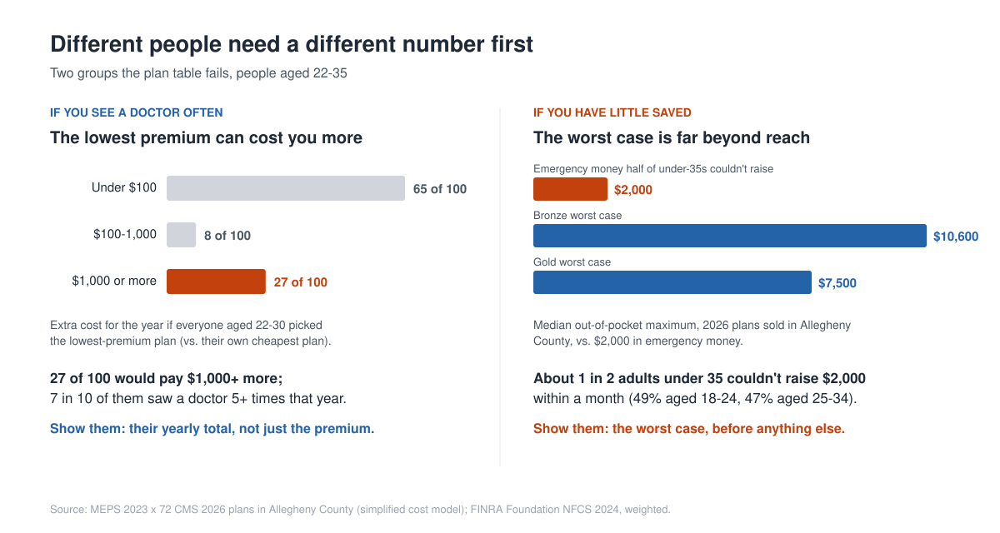
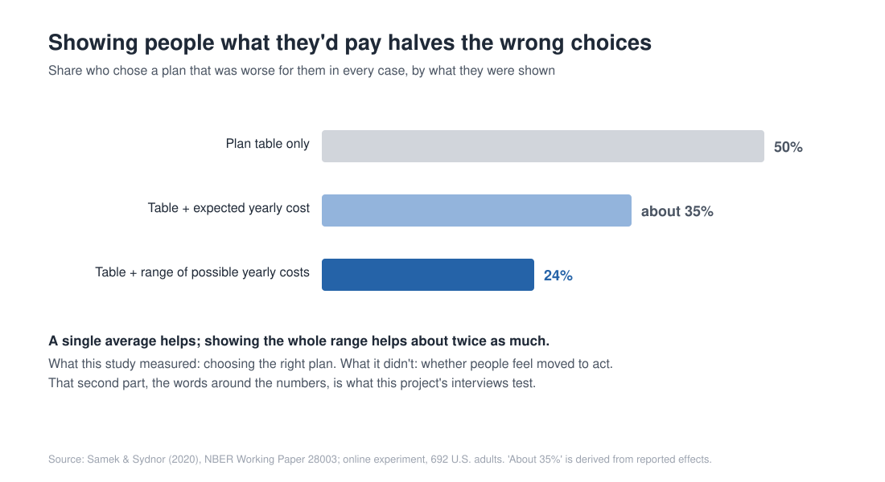
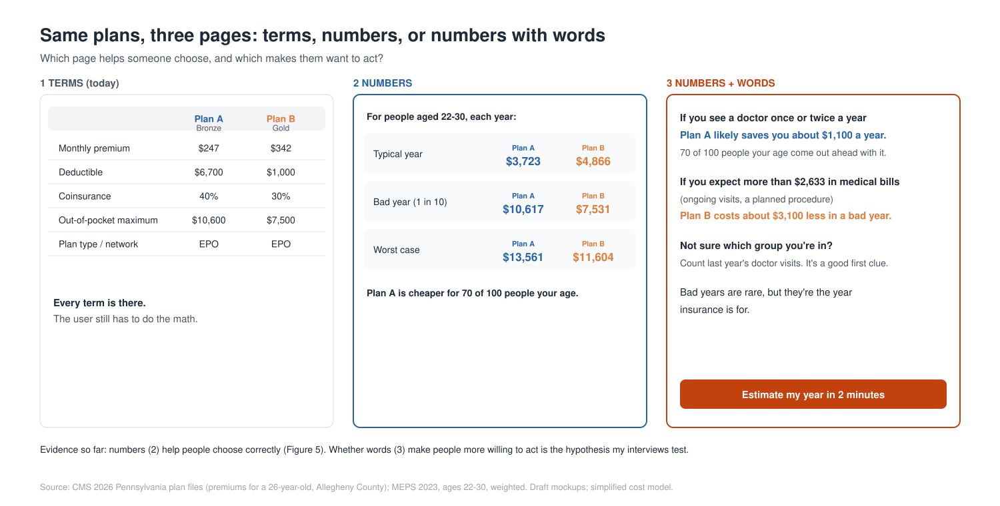
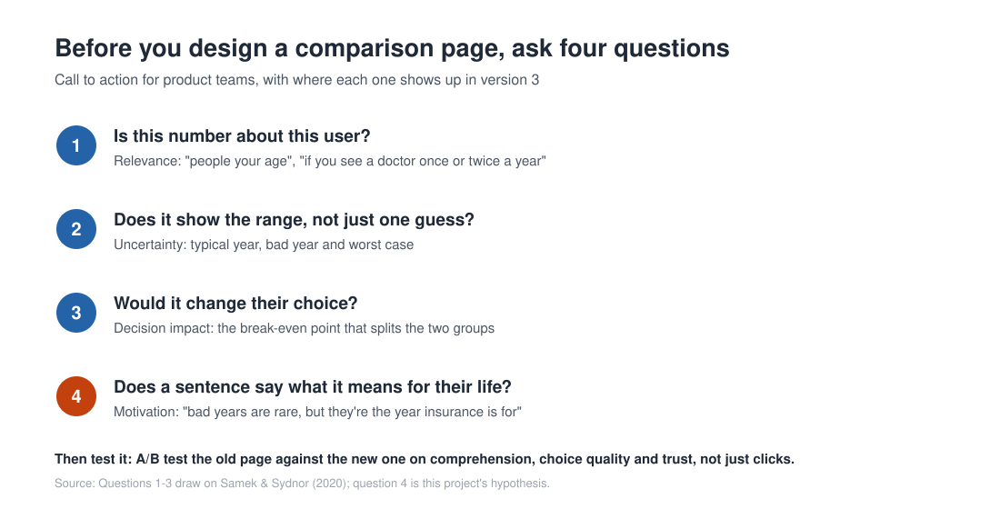

| [Home](README) | [Data Viz Examples](dataviz-examples) | [Critique by Design](critique-by-design) | [Final Project I](final-project-part-one) | [Final Project II](final-project-part-two) | [Final Project III](final-project-part-three) |

# Final Project Part II: What Should We Show?

**Storyboard, draft data visualizations and user research**

**On this page:** [What changed since Part I](#1-what-changed-since-part-i) | [Storyboard](#2-storyboard) | [Draft visualizations](#3-draft-data-visualizations) | [User research protocol](#4-user-research-protocol) | [Interview findings](#5-interview-findings) | [Planned changes](#6-planned-changes-for-part-iii) | [Data and code](#7-data-code-and-method)

---

## 1. What changed since Part I

**One audience, not two.** Part I spoke to young adults choosing a plan *and* to product teams designing comparison pages. This version speaks to **product and design people**: PMs, UX designers and analysts who build pages where users compare complex products. The reader still plays the user for the first two screens, but only so they feel the problem they are being asked to design for.

**Why individual-market plans.** Graduate students and young professionals usually get coverage through a university or employer, and an employer often pays most of the premium, so the numbers in this story would not carry over directly to their own plan. For a product audience, that stops being a problem. The individual marketplace is the clearest case of the design challenge: dozens of plans side by side, no HR department to explain them, and the comparison page is the only help a user gets. The story uses two real 2026 plans sold in Pittsburgh by the same insurer on the same network, so they differ only in the premium/deductible trade-off, which is the same trade-off employer plans ask people to make.

**A sharper argument: numbers *and* words.** Part I argued that people are moved by "the number that's about them." Reworking the story showed that this only covers half of persuasion:

- **Numbers help people choose correctly.** An experiment found that showing people the range of yearly costs they could face, instead of a plan table, cut wrong choices from 50% to 24% ([Samek & Sydnor, 2020](https://www.nber.org/papers/w28003)).
- **Words help people care and act.** A number alone doesn't say what it means for someone's life, why it matters now, or whether to trust it. That part has less direct evidence, so it becomes the hypothesis my interviews test.

**Other changes from feedback:**

- **Before/after** (suggested in feedback): the story opens with the plan table as most pages show it (Figure 1) and ends with the same two plans shown three ways: terms, numbers, and numbers with words (Figure 6).
- **Showing the confusing presentation itself**: Figure 1 shows the real terms of both plans and the questions a user is left with.
- **Research behind the one-sentence summary**: see below.
- **Call-out statistics**: each chart leads with one big number (70 of 100; 27 of 100; $2,000 vs. $10,600; 50% → 24%).
- **Real data everywhere**: Part I had placeholders in two figures; every chart now uses real numbers.

> **One-sentence summary:** Numbers tell people which option fits them; words tell them why it matters to their life, so a good comparison page needs both: lead with the user's own number, then one plain sentence about what it means. The first half rests on experimental evidence ([Samek & Sydnor, 2020](https://www.nber.org/papers/w28003)) and on research showing most people misread plan terms ([Loewenstein et al., 2013](https://www.cmu.edu/news/stories/archives/2013/august/aug1_understandinghealthinsurance.html); [Bhargava, Loewenstein & Sydnor, 2017](https://doi.org/10.1093/qje/qjx011)); the second half is what this project's user research tests.

---

## 2. Storyboard

| Screen | What the reader sees | What they should take away |
| --- | --- | --- |
| 1. Hook | Title, and an invitation to play the user | "This is about how we present choices." |
| 2. Try it | Figure 1: the plan table, with a prompt to pick one | Every number is there; the answer isn't. |
| 3. Reveal | Figure 2: yearly cost of both plans across medical bills | 70 of 100 should pick Plan A, but the table can't tell a user which group they're in. **This is the turning point.** |
| 4. Why it's hard | Figure 3: published research | Users can't do the math the table asks of them. |
| 5. Who needs what | Figure 4: two groups the table fails | Frequent users need their yearly total; people with little saved need the worst case. |
| 6. Evidence | Figure 5: experiment results | Showing yearly costs halves wrong choices. Numbers help people choose. |
| 7. Three versions | Figure 6: terms, numbers, numbers + words | Does a plain sentence about what the number means make people want to act? |
| 8. Call to action | Figure 7: four questions for product teams | Relevance, uncertainty, decision impact, motivation; then A/B test. |

**Medium:** the final story is planned as a scrolling story in Shorthand with interactive Tableau Public charts (to be confirmed with the instructor; Part I proposed a GitHub page with Tableau). These drafts were built in Python from the data in this repository so that every number is reproducible.

---

## 3. Draft data visualizations

All charts use real data. Plan A and Plan B are two 2026 plans sold in Allegheny County by UPMC on the same network; premiums are for a 26-year-old.

### Figure 1: Which plan would you choose? (before)

Plan A costs $247 a month with a $6,700 deductible; Plan B costs $342 with a $1,000 deductible. The table is accurate but leaves the user to work out what it means for them.

### Figure 2: 70 of 100 should pick Plan A. The table can't tell you which group you're in.

Below $2,633 in medical bills a year, Plan A is cheaper; above it, Plan B is. About 70 of 100 people aged 22–30 spend less than that, so Plan A is the right choice for most of them. The problem is not that people pick Plan A; it's that nothing on the table tells a user whether they are one of the 70 or one of the 30.

### Figure 3: It's not just you

Published research: only 14% of insured adults understood four basic terms, and 61% of employees at one firm chose a plan that was worse for them in every case.

### Figure 4: Different people need a different number first

Left: if everyone aged 22–30 picked the lowest-premium plan among all 72 plans in the county, 27 of 100 would pay at least $1,000 more than their best plan, and 7 in 10 of those people saw a doctor five or more times that year. Right: about half of adults under 35 couldn't raise $2,000 within a month, while a Bronze plan's worst case is $10,600. Each group needs a different number first.

### Figure 5: Showing people what they'd pay halves the wrong choices

In an online experiment with 692 U.S. adults, half of those who saw only a plan table chose a plan that was worse for them in every case. Adding a single expected cost helped somewhat; showing the range of possible yearly costs cut wrong choices to 24%. The study measured choosing correctly, not motivation, which is why the words in Figure 6 are tested in interviews.

### Figure 6: Terms, numbers, or numbers with words

The same two plans as three pages. Version 2 shows the yearly totals for a typical year, a bad year and the worst case. Version 3 adds sentences that say who each plan fits, what it saves them, how to tell which group they're in, and why a bad year matters, without scare language.

### Figure 7: Before you design a comparison page, ask four questions

The call to action for product teams. Questions 1–3 draw on the experimental evidence; question 4 (motivation) is this project's hypothesis.

---

## 4. User research protocol

### Research goals

1. **Comprehension:** can readers understand each chart on their own?
2. **The turning point:** after Figure 2, do readers see what's wrong with the plan table, or do they conclude the table is fine because most people should pick Plan A anyway?
3. **Numbers vs. words:** which of the three versions in Figure 6 helps them choose, and which makes them want to act? Do the sentences in version 3 add trust and motivation, or feel like marketing?
4. **Usefulness:** would they use the four questions in their own product work?
5. **Relevance of the example:** does the individual-market example feel relevant, or does it get in the way?

### a. Target audience

People who build, or are training to build, consumer products where users compare options: product managers, UX and product designers, and data or business analysts. This includes graduate students preparing for these roles, who are also the readers of this portfolio.

### b. Finding representative interviewees

- **Who:** at least three people, chosen to cover different angles of the audience:
  - one or two graduate students preparing for product or analytics roles (e.g., Heinz MISM or Information Systems);
  - one person with design or HCI training;
  - if possible, one person who has worked as a PM or designer.
- **Screening:** has worked on or studied a product where users compare options (pricing pages, plan pickers, checkout); has not seen this project before. A mix of people who have and haven't chosen a health plan themselves.
- **How:** recruited through class and program networks and former internship contacts. Interviews take 25–30 minutes, in person or by video, using the storyboard and figures on this page.
- **Privacy:** participants are described only by role and age range. No names, employers or other identifying details are recorded, and notes are kept without names.

### c. Interview script

**Introduction (2 min):** "I'm working on a data story about how comparison pages present complex choices. I'll show you some draft screens and ask what you see. There are no wrong answers; I'm testing the charts, not you. Please think aloud."

**Warm-up (3 min)**

1. What kind of product work do you do, or want to do?
2. Have you ever chosen a health plan yourself? What did you look at first?
3. Think of a product page that helped you choose between options. What did it do well?

**Part 1: playing the user (5 min)**

| Goal | Screen shown | Questions to ask |
| --- | --- | --- |
| 2 | Figure 1 (plan table) | Which plan would you pick, and why? How confident are you, from 1 to 5? What's missing that you'd want to know? |
| 1, 2 | Figure 2 (cost curves) | What do you notice first? Does this change your choice? |
| 2 | Figure 2 | **Most people should pick Plan A anyway. Is the original table still fine? Why or why not?** |

**Part 2: the evidence (5 min)**

| Goal | Screen shown | Questions to ask |
| --- | --- | --- |
| 1 | Figure 3 (research) | In your own words, what does this say? Anything surprising? |
| 1 | Figure 4 (who needs what) | What is the main point? Is anything confusing or hard to read? Which group do you identify with? |
| 1, 3 | Figure 5 (experiment) | What does this chart tell you about what to show users? Do you find it convincing? |

**Part 3: numbers vs. words (8 min)**

Show the three versions of Figure 6 one at a time, in a different order for each person, then side by side.

| Goal | Questions to ask |
| --- | --- |
| 3 | For each version: which plan would you pick, and how confident are you (1–5)? |
| 3 | Which version helps you **decide**? Which makes you most **want to act**, e.g., click "Estimate my year"? Are those the same version? |
| 3 | Which version do you **trust** most? Did any sentence feel like a sales pitch or a scare tactic? |
| 3 | Point to the one sentence in version 3 that matters most to you, and the one you'd cut. |
| 3 | If you were shipping this page, which version would you ship, and what would you change? |
| 5 | These are individual-market plans, not employer plans. Did that matter to you? |

**Part 4: wrap-up (4 min)**

| Goal | Questions to ask |
| --- | --- |
| 4 | Look at the four questions in Figure 7. Which would you actually use at work? Is any of them unclear or unnecessary? |
| 1 | In one sentence, what is this story's main message? |
| 1 | What would you remove from the story, and what would you add? |
| 1 | How clear was the story overall, from 1 to 5? |

**What I'll record:** plan choice and confidence after Figure 1, after Figure 2 and for each version in Figure 6; whether they think the table is "fine" after Figure 2; the version they'd ship and the one that makes them want to act; sentences they'd keep or cut; where they paused or misread a chart; direct quotes; their one-sentence summary; clarity ratings.

---

## 5. Interview findings

*Interviews are being scheduled. This section will be filled in with what participants actually said and did; nothing here is invented.*

| Question | Interview 1 (role, age range) | Interview 2 | Interview 3 |
| --- | --- | --- | --- |
| Plan choice and confidence: Figure 1 → Figure 2 | | | |
| Is the table "still fine" after Figure 2? | | | |
| Charts that confused them | | | |
| Version that helps them decide | | | |
| Version that makes them want to act | | | |
| Sentence they'd keep / cut in version 3 | | | |
| Version they'd ship | | | |
| Did the individual-market example matter? | | | |
| Most useful of the four questions | | | |
| Their one-sentence summary | | | |
| Clarity rating (1–5) | | | |

**Consistent feedback:** *(to be added)*

**Conflicting feedback:** *(to be added)*

**Key quotes:** *(to be added)*

---

## 6. Planned changes for Part III

*To be completed from the interview findings.* Each change will be listed with the finding that prompted it.

---

## 7. Data, code and method

- **Data:** [data folder](data/README.md) with extracts of MEPS 2023, CMS 2026 Pennsylvania plan files and FINRA NFCS 2024, a data dictionary, and the published research figures used in Figures 3 and 5.
- **Code:** [`analysis/fig_plan_pair.py`](analysis/fig_plan_pair.py) (Plans A and B), [`analysis/fig3_fig4.py`](analysis/fig3_fig4.py) (Figure 4), [`analysis/make_part2_figures.py`](analysis/make_part2_figures.py) (charts) and [`analysis/make_storyboard.py`](analysis/make_storyboard.py) (storyboard).
- **Cost model (simplified):** yearly total = 12 months of premium + out-of-pocket cost, where out-of-pocket cost is the medical bill up to the deductible, then the coinsurance share, capped at the out-of-pocket maximum. Copays, separate drug deductibles and network differences are not yet included, and each person's total medical spending in MEPS stands in for the bill their plan would see. These will be refined for Part III.
- **Figure 5 note:** the 50% and 24% figures are stated in the paper; "about 35%" for the expected-cost condition is derived from the reported treatment effect.

**AI acknowledgement:** I used ChatGPT and Claude to help scope the project, verify data sources, write analysis code, draft the charts and storyboard, and edit this page. I reviewed the outputs and checked each number on the charts against the data.

[Back to portfolio](README) | [Back to top](#final-project-part-ii-what-should-we-show)
