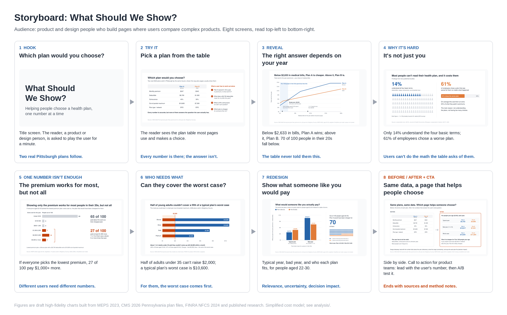
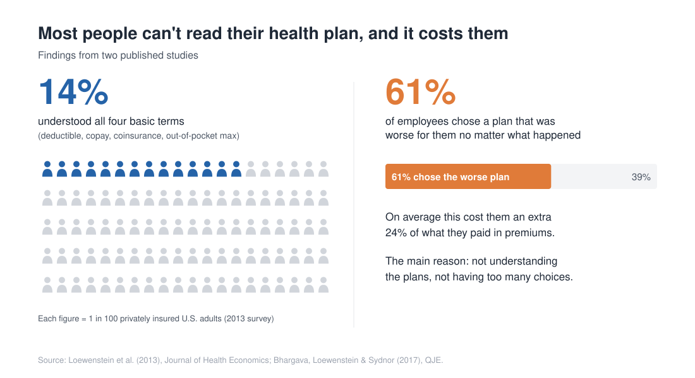
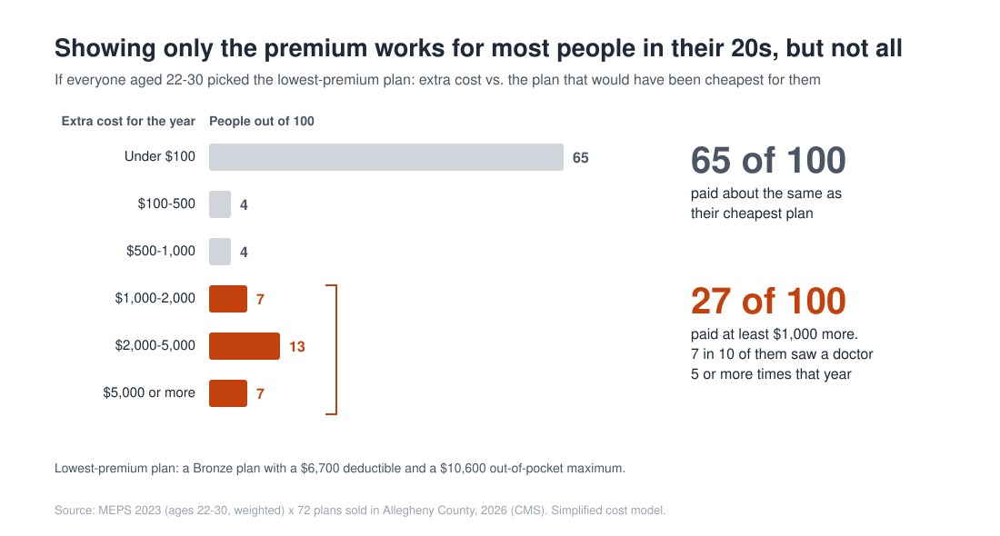
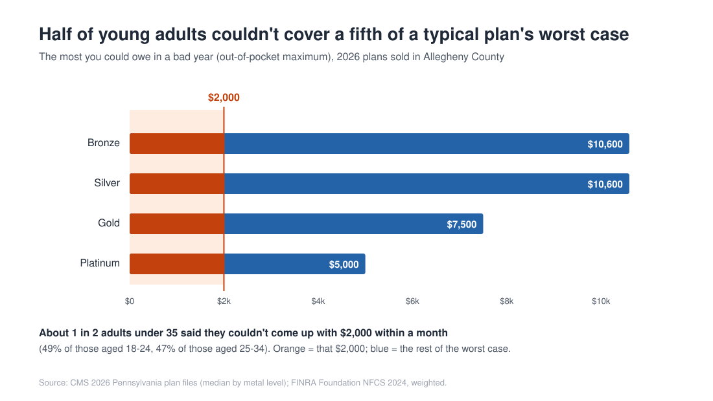
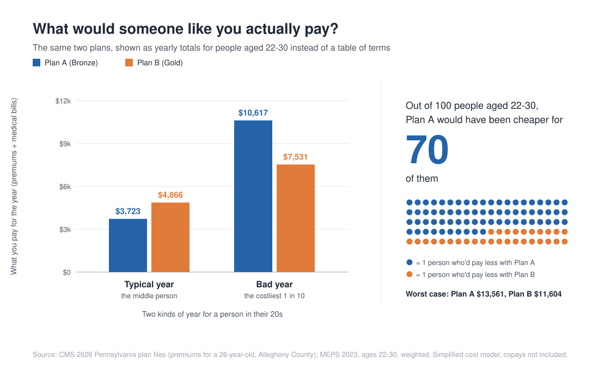
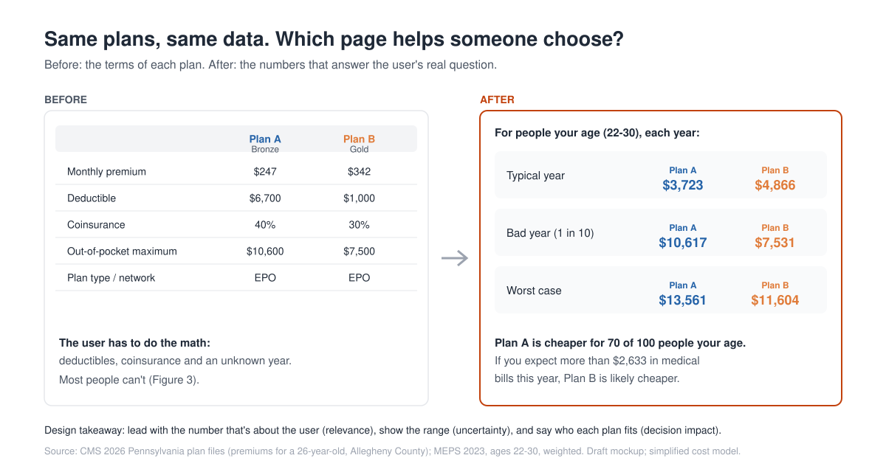

| [Home](README) | [Data Viz Examples](dataviz-examples) | [Critique by Design](critique-by-design) | [Final Project I](final-project-part-one) | [Final Project II](final-project-part-two) | [Final Project III](final-project-part-three) |

# Final Project Part II: What Should We Show?

**Storyboard, draft data visualizations and user research**

**On this page:** [What changed since Part I](#1-what-changed-since-part-i) | [Storyboard](#2-storyboard) | [Draft visualizations](#3-draft-data-visualizations) | [User research protocol](#4-user-research-protocol) | [Interview findings](#5-interview-findings) | [Planned changes](#6-planned-changes-for-part-iii) | [Data and code](#7-data-code-and-method)

---

## 1. What changed since Part I

Part I feedback raised two main points, and both shaped this draft.

**One audience, not two.** Part I spoke to young adults choosing a plan *and* to product teams designing comparison pages. This version speaks to **product and design people**: PMs, UX designers and analysts who build pages where users compare complex products. The reader still plays the user for the first two screens, but only so they feel the problem they are being asked to design for.

**Why individual-market plans.** Graduate students and young professionals usually get coverage through a university or employer, and an employer often pays most of the premium, so the numbers in this story would not carry over directly to their own plan. For a product audience, that stops being a problem. The individual marketplace is the clearest case of the design challenge: dozens of plans side by side, no HR department to explain them, and the comparison page is the only help a user gets. The story uses two real 2026 plans sold in Pittsburgh by the same insurer on the same network, so they differ only in the premium/deductible trade-off, which is the same trade-off employer plans ask people to make.

**Other changes from feedback:**

- **Before/after** (suggested in feedback): the story now opens with the plan table as most pages show it (Figure 1) and ends with the same two plans redesigned around the user's own numbers (Figures 6 and 7).
- **Showing the confusing presentation itself**: Figure 1 shows the real terms of both plans and the questions a user is left with.
- **Research behind the one-sentence summary**: see below.
- **Call-out statistics**: each chart now leads with one big number (break-even at $2,633; 27 of 100; $2,000 vs. $10,600; 70 of 100).
- **Real data everywhere**: all charts now use real numbers; Part I had placeholders in Figures 1 and 5.

> **One-sentence summary:** People comparing complex products aren't helped by more terms or by risk warnings; they're helped by the number that's about them, so lead with it. This follows experimental evidence that showing people the financial consequences of each plan, rather than its features, leads to better choices ([Samek & Sydnor, 2020](https://www.nber.org/papers/w28003)), and that most people misunderstand basic plan terms ([Loewenstein et al., 2013](https://www.cmu.edu/news/stories/archives/2013/august/aug1_understandinghealthinsurance.html); [Bhargava, Loewenstein & Sydnor, 2017](https://doi.org/10.1093/qje/qjx011)).

---

## 2. Storyboard

| Screen | What the reader sees | What they should take away |
| --- | --- | --- |
| 1. Hook | Title, and an invitation to play the user | "This is about how we present choices." |
| 2. Try it | Figure 1: the plan table, with a prompt to pick one | Every number is there; the answer isn't. |
| 3. Reveal | Figure 2: yearly cost of both plans across medical bills | The right choice depends on the user's year, which the table hides. |
| 4. Why it's hard | Figure 3: published research | Users can't do the math the table asks of them. |
| 5. One number isn't enough | Figure 4: what happens if everyone picks the cheapest premium | The premium is right for most, very wrong for some. |
| 6. Who needs what | Figure 5: worst case vs. what young adults can raise | For people without a cushion, the worst case comes first. |
| 7. Redesign | Figure 6: what someone like you would pay | Lead with the user's number and show the range. |
| 8. Before/after + call to action | Figure 7: both versions side by side | Three tests for any comparison page, then an A/B test. |

**Call to action for product teams:** before choosing what to put on a comparison page, ask three questions. Is this number about *this* user (relevance)? Does it show the range of what could happen (uncertainty)? Would it change their choice (decision impact)? Then test the redesigned page against the old one.

**Medium:** the final story is planned as a scrolling story in Shorthand with interactive Tableau Public charts (to be confirmed with the instructor; Part I proposed a GitHub page with Tableau). These drafts were built in Python from the data in this repository so that every number is reproducible.

---

## 3. Draft data visualizations

All charts use real data. Plan A and Plan B are two 2026 plans sold in Allegheny County by UPMC on the same network; premiums are for a 26-year-old.

### Figure 1: Which plan would you choose? (before)

Plan A costs $247 a month with a $6,700 deductible; Plan B costs $342 with a $1,000 deductible. The table is accurate but leaves the user to work out what it means for them.

### Figure 2: The right answer depends on your year

Below $2,633 in medical bills a year, Plan A is cheaper; above it, Plan B is. Half of people aged 22–30 spend less than $762 a year, and about 70 of 100 spend less than the break-even point.

### Figure 3: It's not just you

Published research: only 14% of insured adults understood four basic terms, and 61% of employees at one firm chose a plan that was worse for them in every case.

### Figure 4: The premium works for most, but not all

If everyone aged 22–30 picked the lowest-premium plan (which is Plan A) out of all 72 plans sold in the county, 65 of 100 would pay about the same as their best plan, but 27 of 100 would pay at least $1,000 more.

### Figure 5: Can they cover the worst case?

About half of adults under 35 couldn't come up with $2,000 within a month, while the median worst case for Bronze and Silver plans in the county is $10,600.

### Figure 6: What would someone like you actually pay? (after)

In a typical year Plan A costs $3,723 and Plan B $4,866; in a bad year (the costliest 1 in 10) Plan A costs $10,617 and Plan B $7,531. Plan A is cheaper for 70 of 100 people aged 22–30. (Figure 4 compares against all 72 plans, so its numbers differ slightly from this two-plan comparison.)

### Figure 7: Before and after

The same data presented two ways. This is the design recommendation of the story.

---

## 4. User research protocol

### Research goals

1. Can readers understand each chart on their own, without explanation?
2. Does the opening (playing the user) make the design problem feel real?
3. After the story, do readers believe the "after" page helps users more than the "before" page, and why?
4. Is the takeaway something they could use in their own product work?
5. Does the individual-market example feel relevant, or does it get in the way?

### a. Target audience

People who build, or are training to build, consumer products where users compare options: product managers, UX and product designers, and data or business analysts. This includes graduate students preparing for these roles, who are also the readers of this portfolio.

### b. Finding representative interviewees

- **Who:** at least three people, chosen to cover different angles of the audience:
  - one or two graduate students preparing for product or analytics roles (e.g., Heinz MISM or Information Systems);
  - one person with design or HCI training;
  - if possible, one person who has worked as a PM or designer.
- **Screening:** has worked on or studied a product where users compare options (pricing pages, plan pickers, checkout); has not seen this project before. A mix of people who have and haven't chosen a health plan themselves.
- **How:** recruited through class and program networks and former internship contacts. Interviews are 20–25 minutes, in person or by video, and use the storyboard and figures on this page.
- **Privacy:** participants are described only by role and age range. No names, employers or other identifying details are recorded, and notes are kept without names.

### c. Interview script

**Introduction (2 min):** "I'm working on a data story about how comparison pages present complex choices. I'll show you some draft screens and ask what you see. There are no wrong answers; I'm testing the charts, not you. Please think aloud."

**Warm-up (3 min)**

1. What kind of product work do you do, or want to do?
2. Have you ever chosen a health plan yourself? How did you decide?

**Walk-through (15 min)**

| Goal | Screen shown | Questions to ask |
| --- | --- | --- |
| 2 | Figure 1 (plan table) | Which plan would you pick, and why? How confident are you (1–5)? |
| 1, 2 | Figure 2 (cost curves) | What do you notice first? What is this chart telling you? Does it change your choice? |
| 1 | Figure 3 (research) | In your own words, what does this say? Anything surprising? |
| 1, 3 | Figures 4 and 5 | What is each chart's main point? Is anything confusing or hard to read? |
| 3 | Figures 6 and 7 (after, and before/after) | Which version would you ship, and why? What's missing from the "after" version? |
| 5 | Any screen | These are individual-market plans, not employer plans. Did that matter to you? |

**Wrap-up (5 min)**

1. In one sentence, what is this story's main message?
2. Is there anything you'd do differently in your own work after seeing this?
3. What would you remove, and what would you add?
4. How clear was the story overall (1–5)?

**What I'll record:** each person's first plan choice and confidence; where they paused or misread a chart; direct quotes; their one-sentence summary; clarity ratings.

---

## 5. Interview findings

*Interviews are being scheduled. This section will be filled in with what participants actually said and did; nothing here is invented.*

| Question | Interview 1 (role, age range) | Interview 2 | Interview 3 |
| --- | --- | --- | --- |
| First plan choice and confidence | | | |
| Figure 2: what they noticed first | | | |
| Charts that confused them | | | |
| Before or after, and why | | | |
| Did the individual-market example matter? | | | |
| Their one-sentence summary | | | |
| Clarity rating (1–5) | | | |

**Consistent feedback:** *(to be added)*

**Conflicting feedback:** *(to be added)*

**Key quotes:** *(to be added)*

---

## 6. Planned changes for Part III

*To be completed from the interview findings.* Each change will be listed with the finding that prompted it.

---

## 7. Data, code and method

- **Data:** [data folder](data/README.md) with extracts of MEPS 2023, CMS 2026 Pennsylvania plan files and FINRA NFCS 2024, plus a data dictionary.
- **Code:** [`analysis/fig_plan_pair.py`](analysis/fig_plan_pair.py) (Plans A and B), [`analysis/fig3_fig4.py`](analysis/fig3_fig4.py) (Figures 4 and 5), [`analysis/make_part2_figures.py`](analysis/make_part2_figures.py) (charts) and [`analysis/make_storyboard.py`](analysis/make_storyboard.py) (storyboard).
- **Cost model (simplified):** yearly total = 12 months of premium + out-of-pocket cost, where out-of-pocket cost is the medical bill up to the deductible, then the coinsurance share, capped at the out-of-pocket maximum. Copays, separate drug deductibles and network differences are not yet included, and each person's total medical spending in MEPS stands in for the bill their plan would see. These will be refined for Part III.

**AI acknowledgement:** I used ChatGPT and Claude to help scope the project, verify data sources, write analysis code, draft the charts and storyboard, and edit this page. I reviewed the outputs and checked each number on the charts against the data.

[Back to portfolio](README) | [Back to top](#final-project-part-ii-what-should-we-show)
